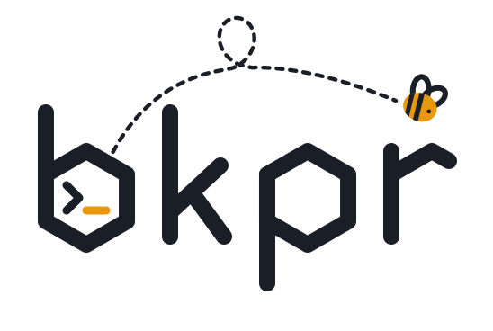

<p align="center">
  <picture>
    <source media="(prefers-color-scheme: dark)" srcset="assets/logo/bkpr-banner-dark.svg">
    
  </picture>
</p>

Bkpr is a terminal multiplexer for working across projects, machines and coding
agents. Split terminals into panes, group windows into workspaces, and keep local
and SSH sessions in one sidebar.

Agents keep their own UIs. Bkpr adds project context, conversation recovery and
agent messaging. Detach when you're done for now; your programs keep running.

<p align="center">
  <br>
  <sub><em>Bkpr running in a terminal with Kitty graphics enabled.</em></sub>
</p>

*Pi and Claude Code exchange real Bkpr messages in this scripted demo. Codex runs
in another window, and a second session runs over SSH.
[Reproduce the screenshot](docs/reference.md#screenshot-maintenance).*

## Install and start

Bkpr is packaged with Nix for x86-64 Linux, ARM64 Linux and ARM64 macOS.
The package includes matching `bkpr` and `bkprd` binaries. Managed harness
capture hasn't been verified on macOS.

On Apple Silicon, download `bkpr-macos-arm64-unsigned.pkg` from
[GitHub Releases](https://github.com/calops/bkpr/releases) to install without
Nix. The installer is unsigned and may require Gatekeeper approval. Once
installed, run `bkpr` in a new terminal.

### Install with Nix

```sh
# Try it without installing.
nix run --accept-flake-config github:calops/bkpr

# Or install it into your profile.
nix profile install --accept-flake-config github:calops/bkpr
bkpr
```

`--accept-flake-config` accepts the project's binary cache settings. Bkpr uses
your existing shell and harness setup. It doesn't change your profiles, sign
in to agent accounts or approve trust prompts.

### Run from source

```sh
git clone https://github.com/calops/bkpr.git
cd bkpr
nix develop --command just run
```

This builds and runs the checkout, including its pinned terminal engine.
See [Build from source](docs/reference.md#build) for prerequisites and build-only commands.

Use a development sandbox to keep the checkout's test daemon and sessions
separate from your normal ones:

```sh
nix develop --command just sandbox chat -- run omp
nix develop --command just sandbox chat -- daemon info
nix develop --command just sandbox chat
```

Arguments after `--` go to `bkpr`. `run HARNESS` starts the wrapper inside the
first pane of a fresh sandbox. To run another harness in an existing sandbox,
attach and run `bkpr run HARNESS` in one of its panes. The sandbox keeps its
matching binaries while its daemon is running. `just sandbox-stop chat` stops
that daemon and deletes the sandbox's saved state.

### First workspace

1. Run `bkpr --session work` to start or attach to a named session.
2. Press `Ctrl-b`, then `%` to split left/right, or `"` to split top/bottom.
3. Press `Ctrl-Space` for the sidebar. Use `n` for a new workspace or `N` for a
   separate window. Use arrows and Enter to choose where to work.
4. Press `Ctrl-b`, then `d` to detach. Run `bkpr --session work` to return.

A workspace holds one or more windows. Each window has its own split layout.
Select a workspace name to open its channels, or select a pane to return to its
native application. The disclosure arrow only folds the tree.
Right-click a sidebar row for workspace, window and pane actions.

## Work across sessions and machines

Named sessions share one `bkprd` per host and user, but keep separate workspaces and layouts:

```sh
bkpr --session work
bkpr --session review
bkpr list
bkpr -s work -s review
```

Attach to an **already-running** session on an SSH host, or combine local and
remote sessions in one sidebar:

```sh
bkpr --remote devbox --session work
bkpr -s local:work -s devbox:review
```

Use matching Bkpr builds on both hosts. Start the remote session and check that
SSH works before attaching. Bkpr doesn't install anything or start a daemon on
the remote host. OpenSSH aliases and `ProxyJump` work as usual. Agent forwarding
is off unless you pass `--forward-agent`.

`bkpr -s work -d` detaches other clients without stopping their programs.
`bkpr stop -s work` stops that session and its programs. Closing a window or
workspace also stops its terminals, including hidden ones.

The daemon stays up after the last session closes. `bkpr daemon info` checks it
without starting it; `bkpr daemon stop` stops it and all of its sessions.

See [remote sessions](docs/reference.md#remote-sessions) for connection options,
reconnect behavior and headless commands.

## Keep agents in their native UIs

Install and authenticate your preferred harness, then launch it inside a Bkpr
pane. Explicit launches avoid relying on PATH wrappers:

```sh
bkpr run claude
bkpr run codex
bkpr run omp
bkpr run opencode
bkpr run pi
```

`bkpr run` connects the harness's own conversation to Bkpr's messaging and
recovery tools. Native arguments still work, for example `bkpr run codex -- resume`.

Managed harnesses are Claude Code, Codex, Omp, OpenCode 2, Pi and Antigravity.
The optional `nix develop .#harnesses` shell supplies pinned native CLIs.

To install hooks or plugins outside a managed launch, check the changes first:

```sh
bkpr install claude --dry-run
bkpr install claude
```

Antigravity (`agy`) requires installation. The other managed harnesses can use
`bkpr run` without it. Run `bkpr install` on the machine and account that run
the harness. It preserves unrelated settings. Claude and fresh managed Codex
threads get named Bkpr collaboration defaults; native restrictions still apply.

See the [harness reference](docs/reference.md#harness-capture) for recognized
but unmanaged harnesses, native modes that pass through without capture, and
`--inspect`, `--update` and `--uninstall`.

### Let agents hand work to each other

Launch two managed harnesses in the same workspace. Ask one to find the other's
launch ID with `discover_agents` and send a task using `channel_post` with
`recipient: {launch_id}`. The recipient resolves the native `channel_wake`,
reads the message, and calls `channel_ack` after processing it. Either agent
can reply using the message's `reply_target`.

Bkpr delivers messages through the harness integration, not by typing into its
terminal. Every direct message requests a wake, but an accepted message hasn't
necessarily been delivered or read. Agents can communicate within a session,
not across sessions or hosts. Peer messages aren't user instructions.

See [agent communication](docs/reference.md#agent-communication) for tool names,
scopes, retention and per-harness notification behavior.

### Talk to agents in workspace channels

Open a workspace by name to reach `#desk` or choose another channel with Tab.
Type `@` and select an agent to address its current conversation. The composer
shows who can wake. Enter sends; Shift-Enter adds a line on terminals that
report it separately. Paste does not send.
Agent-to-agent threads are visible but read-only. Chat does not replace or stop
the native panes.

See [workspace channels](docs/reference.md#workspace-channels) for drafts,
history, settings and unread attention.

### Get desktop alerts

With OSC 99 support, Bkpr can show desktop alerts for harness status and
channel questions or reports. Click an alert to open its original pane or
message if the terminal supports activation and the source is still available.
Each TUI skips a source you're already viewing there. Delivery is best effort.
See [desktop notifications](docs/notifications.md#desktop-providers).

### Return to a conversation

When you restart a session, Bkpr restores its layout and reopens shells or
verified native conversations. It doesn't replay old shell commands.

Press `Ctrl-b r` to search saved conversations in the selected or current
session. Pick one and press Enter or click **Resume**. The list shows why a
live or unavailable conversation can't be resumed. Read-only clients can
browse without starting anything.

To inspect saved conversations from the CLI:

```sh
bkpr --session work resume
bkpr --session work resume --pane PANE_ID
```

Start the named session first if it's stopped. Recovery uses the harness's
current configuration and approvals. If the saved conversation is missing,
Bkpr reports an error instead of opening a new one.
See [conversation recovery](docs/reference.md#explicit-harness-recovery).

## Essential keys

Press and release `Ctrl-b` before pressing the next key. The on-screen guide
shows the keys for the current mode. Run `bkpr keys` for the full list.

| Key | Action |
| --- | --- |
| `Ctrl-Space` | Enter sidebar; Esc returns to the application |
| Sidebar `n` / `N` / `r` | New workspace / new window / rename selection |
| Sidebar `x` / Delete | Confirm closing the selected entity and its programs |
| `Ctrl-b %` / `Ctrl-b "` | Split left/right / top/bottom |
| `Ctrl-b` arrows / Tab | Focus neighboring / next pane |
| `Ctrl-b` Shift+arrows | Exchange pane positions |
| `Ctrl-b w` / `W` / `o` | Choose workspace / window / pane |
| `Ctrl-b [` / `]` | Previous / next workspace |
| `Ctrl-b e` | Resize with arrows; Enter or Esc finishes |
| `Ctrl-b s` / Shift+PageUp | Enter scrollback |
| `Ctrl-b /` | Search terminal contents |
| Sidebar `/` | Find panes by metadata |
| `Ctrl-b i` | Inspect the focused pane's local Git/project facts |
| `Ctrl-b g` / `t` | Toggle decorative graphics / choose theme |
| `Ctrl-b r` / `R` | Resume a saved conversation / explicitly reopen with a shell |
| Alt+left-click an image | Open the full image; Esc or × closes the viewer |
| `Ctrl-b d` | Detach without stopping programs |
| `Ctrl-b Ctrl-b` | Send literal Ctrl-b to the live application |

Mouse users can activate sidebar items, drag dividers and select terminal text.
Double-click a divider to balance its two sides. Mouse-aware applications retain
their own gestures; host terminals may reserve selection shortcuts.
See [copy and selection](docs/reference.md#selection-and-copy).

### Decorative graphics cache

Bkpr caches reusable decorations in `$XDG_CACHE_HOME/bkpr/chrome` (or
`~/.cache/bkpr/chrome`), up to 128 MiB and 256 entries across versions. It
doesn't cache pane images, terminal text or scrollback. You can delete the
cache; Bkpr rebuilds it as needed.

## Current limits

- Before 1.0, protocol and storage formats can change. Upgrades don't replace
  running daemons. Keep matching binaries for sessions you haven't stopped.
- Layouts and recovery metadata survive daemon restarts. Processes, terminal
  contents and scrollback don't.
- Managed capture on Linux needs kernel peer-PIDFD support. Recognition alone
  doesn't mean a harness is connected and ready to receive messages.
- Fancy chrome needs Kitty graphics and color support. Other terminals get
  text borders. Theme choices aren't saved.
- Layouts and agent discovery stay within each session. GitHub.com is the
  supported forge; the finder doesn't filter by PR, CI or ticket.
- Bkpr doesn't migrate old Zellij sessions. Release notes through 0.4.2 cover
  the Zellij version.

## More

- [Full reference](docs/reference.md): CLI, remote access, harnesses, controls,
  clipboard, Git/CI and ownership contracts.
- [Development](docs/reference.md#build): source builds, prerequisites and
  [tests](docs/reference.md#tests).
- [Screenshot maintenance](docs/reference.md#screenshot-maintenance): how to regenerate the demo.
- [Implementation plan](docs/pane-first-mux/implementation-plan.md),
  [architecture assessment](docs/pane-first-mux/assessment.md) and
  [native runtime evidence](docs/pane-first-mux/engine-proof.md).
- [Changelog](CHANGELOG.md) and [packaging/release policy](docs/reference.md#packaging-and-releases).

MIT; see [LICENSE](LICENSE).
