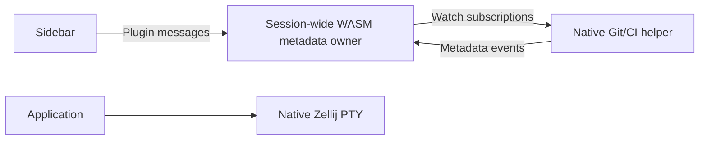

# shephrd

Workspace-first native Zellij terminals and sidebar. One Rust workspace, two executables: a native launcher/metadata helper and a Rust WASM plugin.

## Run

From this checkout:

```sh
nix run .
nix run . -- --session project
```

To expose the single command in a Nix profile:

```sh
nix profile install .
shephrd --session project
```

`shephrd --help` shows session selection, sidebar width and launch examples. Clap generates option help from the Rust parser declarations; examples are a hand-written footer. Internal process/project inspection and metadata-helper commands are hidden. Developer overrides remain available but are hidden from help: `--zellij` / `SHEPHRD_ZELLIJ` and `--plugin` / `SHEPHRD_PLUGIN`. The product supports native Zellij sessions only; there are no remote-backend or saved-machine options.

The default package bundles the native executable, WASM plugin, Zellij 0.45.1, Git and GitHub CLI. Bundled Zellij patches cursor-render ordering (position/shape before showing the cursor), completes keybinding broadcasts only after every recipient has handled them, implements OSC 7501 Program Status Protocol and pushes native status/topology events to authorized subscribers. Sessions use native Zellij terminals without a second PTY owner. A session-private native helper owns Git filesystem events and shared CI requests.

The native-only cutover was exercised in actual Kitty (`target/native-cutover-proof-7od044u3/evidence.json`): startup, right-click context details, collapsed-only workspace badges, ordinary Zellij splits/new tabs, terminal resizing, inactive-terminal OSC status, Git branch event delivery and detach/reattach with unchanged configuration and owner identity. Removed backend options/helpers fail CLI parsing; help exposes only session and sidebar-width options. All 162 workspace tests, host/WASI Clippy and debug builds passed, and the native package wrapper/devshell evaluated without a legacy backend dependency. These were private protocol/CI fixtures, not authenticated harness turns or live provider queries. Private sessions, helpers, GUI processes and scripts were removed; no release build or live-session activation was performed.

On first launch, click the sidebar and approve its Zellij permission request with `y`. The plugin needs application-state access, application-state changes, command execution, plugin messaging and CLI-pipe input. No pane-content permission or viewport inspection is needed. Authorization is cached by Zellij for the plugin artifact. Press Ctrl+Space before using keyboard selection and Enter activation in the sidebar.

The launcher creates a private configuration/layout for this product, not a replacement for your usual Zellij configuration. It inherits stock Zellij keybindings and adds only the shephrd handoff, pane-cycling and detach shortcuts. Application input uses Locked mode. After the initial plugin authorization, Ctrl+Space explicitly enters sidebar keyboard controls; mouse interaction never enters them.

A single left click activates and highlights a workspace or terminal immediately without transferring keyboard focus to the sidebar. Every sidebar replica follows the client's actual native focus; explicit keyboard navigation can temporarily select another row until activation or focus departure. The sidebar is non-selectable outside explicit controls, so stock pane navigation skips it. Ctrl+Space makes it selectable and focuses it; Ctrl+Space or Esc leaves controls and restores the previous application pane. The private session enables Zellij's `mouse_click_through`; no global configuration changes. Only edit dialogs display a sidebar input cursor. Double-click folding remains available. Agent labels prefer explicit shephrd renames, then structured reported titles, then live native application titles (OSC 0/2), then the harness display name. Native titles are display metadata only; they never imply agent activity.

Workspace and terminal first lines use solid `●` project indicators, not duplicate status circles. Workspace dots use the normal light foreground; pane dots and project labels share an identity-derived six-color palette, stable through branch changes, activity and linked worktrees. Canonical Git common-directory identity distinguishes same-named repositories; colors can repeat because the palette is finite. Non-Git/unknown pane identities remain neutral. Material Design Nerd Font icons at the right edge remain the agent lifecycle indicators: `󰏦` idle, `󰦖` working, `󰯅` permission approval, `󰆆` question, `󰍁` authentication, `󰗖` error, `󰀪` unspecified/mixed attention, `󰗡` done and `󰘥` unknown. Use a Nerd Font. Attention retains red coloring, with mixed or unspecified reasons shown generically. Branch detail rows and explicit `CI` badges are independent of agent state; hover popups retain activity/error descriptions and attention reasons.

Both status and harness glyphs reserve a trailing blank cell for double-width Nerd Font artwork. Claude, Codex and Copilot use their available Nerd Font brand glyphs; omp uses pi. OpenCode code tags, Antigravity's rocket, Cursor's pointer, Aider's pencil, Cline's robot and Goose's waterfowl are semantic icon fallbacks, not brand logos. Other applications use an outlined robot. The original native terminal-emitter smoke verified logo/name separation and the trailing status cell in `target/npb_pkotk8-evidence/`.

Harness icons use palette colors: Claude peach, omp purple (`#cba6f7`), Codex/Aider green, OpenCode blue, Antigravity teal, Copilot lavender, Cline cyan and Goose yellow. Cursor uses the normal light foreground rather than muted gray. Agent titles use normal text color, while descriptions remain muted. omp native-title decoration (`π` plus idle/attention/static separators or braille/pulse/ASCII spinner frames) is stripped for display so only the task label remains. Explicit shephrd renames and structured OSC 7501 titles are not stripped; the raw native title remains in the model and never determines status.

The presentation refinement passed an actual private terminal-emitter PTY smoke: all five logo colors, normal title foreground and all supported omp prefix/spinner variants were captured as rendered cells across native states. Evidence is in `target/smoke/colors-k2uvqngk-evidence/`. This verifies the protocol/UI surface, not genuine turns in every harness. All 44 workspace tests and host/WASI Clippy passed; the debug native and WASM builds passed.

Antigravity recognition was exercised with the actual installed `agy` 1.3.3 in a private PTY: the inspector returned its live foreground PID, OS birth identity and private working directory. A rendered-row smoke checked the teal rocket, normal title color and unknown status with `pyte`; this was not a full sidebar UI or authenticated agent-turn verification. The 44 workspace tests and native/WASM debug builds passed.

Every native program uses the same CWD-based second line: muted `󰘬 branch` context and available whole-branch changes/CI. Detached HEAD uses `󰘬 detached @ <short SHA>`. Without a Git branch, the program description is shown instead. Harness recognition does not change detail-row layout. Git metadata follows actual foreground CWD using filesystem events, including atomic HEAD replacement, Git initialization and independent linked-worktree HEADs. Live Git watching currently requires Linux inotify and pidfd support (kernel 5.3+).

Branch detail rows append whole-branch `+added -deleted` counts in subdued green/red when space permits. They compare the committed `HEAD` tree with its merge-base, not the working tree or the base branch's current tip. The diff always covers the entire repository, including from a nested foreground CWD or with `diff.relative=true`; rename detection avoids counting unchanged moves as added/deleted content. The base is resolved locally: an explicit `branch.<name>.gh-merge-base` setting is authoritative; otherwise the tracking remote's default HEAD, origin's default HEAD, available remote main/master refs and local main/master are considered in that order. No automatic fetch is performed. Missing, unborn or unrelated bases are unavailable rather than reported as zero. Base/ref changes use the existing filesystem event watcher.

Popups show normal whole-branch totals, base/merge-base provenance and binary-file changes separately. Tests, documentation, generated files and all other tracked files are included; there is no implementation-classification heuristic or filtered subtotal.

The sidebar uses one Nerd Font `` (`nf-oct-workflow`) colored by CI status, with a reserved trailing cell for its artwork. No adjacent result glyph is shown in badges; individual check rows retain their result icons and explicit status context.

Verification: `target/compact-ui-proof-_q6i4591/evidence.json` records actual Kitty compact rows, adjacent branch totals, a single colored workflow icon, physical Ctrl+Shift+click opening exact PR/check URLs through a private recorder, unlinked chrome and zero whole-display clears across hovered harness transitions. `target/stable-ci-native-rif78dn9/acceptance.json` records three real foreground process birth/exit cycles with unchanged Git/CI/watch tickets and exactly one private provider query, followed by genuine HEAD invalidation without violating the request budget. The provider/model signals were controlled fixtures, not live GitHub/model results. All 115 workspace tests, three native overlay regressions and host/WASI Clippy passed; private fixtures/processes were removed. A minimal Bash fixture separately exposed stale shell/harness labels on return; that is not resolved by the directory-CI fix.

Each sidebar-created terminal occupies its own native Zellij tab, grouped by logical workspace. `n` opens a new workspace in a full application-area view; `N` creates another terminal in the selected workspace in another full application-area view. Both use a resizable sidebar and one full-height application terminal, never a focus-dependent split. Selecting an existing local terminal switches to it rather than duplicating it. Explicit stock splits remain available.

### Harness coverage and OSC reporting

Process recognition covers ten practical CLI targets, not a measured global popularity ranking. Native and Nix-wrapped commands are supported, along with documented Node/Bun entrypoints and Aider's Python entrypoint/module. Cursor's packaged Node launcher is recognized through its installation path, including `--use-system-ca`; an arbitrary program named `agent`, a generic `index.js`, or a harness name in prompt arguments is not sufficient.

Upstream reporting capabilities below were checked on **2026-10-14**. Recognition does not imply semantic status support. Shephrd consumes generic OSC 7501 for lifecycle/attention; progress, window titles, clipboard sequences and notifications are not substitutes.

| Harness | Detected CLI | Current reporting and verified pending work |
| --- | --- | --- |
| Claude Code | `claude`, `claude-code` | Native **OSC 7501**, released in [2.1.295](https://github.com/anthropics/claude-code/releases/tag/v2.1.295). Existing launch-local supplementation is for display titles only. |
| Codex | `codex` | **OSC 7501 in released [0.163.0-alpha.12](https://github.com/openai/codex/releases/tag/rust-v0.163.0-alpha.12)**, not stable [0.162.1](https://github.com/openai/codex/releases/tag/rust-v0.162.1). [The alpha producer](https://github.com/openai/codex/blob/rust-v0.163.0-alpha.12/codex-rs/tui/src/terminal_program_status.rs) reports idle/working/blocked and clear, without message/title/progress fields. |
| OpenCode | `opencode` | Terminal titles exist; semantic **OSC 7501 [PR #54560](https://github.com/anomalyco/opencode/pull/54560) remains open**, not released support. |
| omp | `omp` | Native **OSC 7501**, default-on `terminal.programStatus` since [18.8.7](https://github.com/can1357/oh-my-pi/releases/tag/v18.8.7), plus separate progress/title channels. Upstream Pi is a different product and is not identified as omp. |
| Antigravity | `agy`, `antigravity` | Shephrd automatically bridges the official [state-change statusline callback](https://antigravity.google/docs/cli/statusline) into **OSC 7501** inside managed sessions. No agy plugin or manual configuration is required; this is an adapter, not a native OSC 7501 producer. |
| Cursor Agent | `cursor-agent`, official `agent` launcher | Optional [terminal-title status indicators](https://cursor.com/docs/cli/reference/configuration); no documented OSC 7501 producer located. The docs do not specify the title's OSC selector. |
| GitHub Copilot CLI | `copilot` | Default-on **OSC 9;4 progress** and optional terminal notifications, not semantic OSC 7501; see [configuration](https://docs.github.com/en/copilot/reference/copilot-cli-reference/cli-config-dir-reference) and [OSC 777 notification release](https://github.com/github/copilot-cli/blob/main/changelog.md#1088---2026-09-22). |
| Aider | `aider`, `python -m aider` | [OS notifications/BEL](https://aider.chat/docs/usage/notifications.html), not a located OSC 7501 producer. |
| Cline CLI | `cline` | Native [terminal title updates](https://github.com/cline/cline/blob/main/apps/cli/src/tui/utils/terminal-title.ts); no OSC 7501 producer located. Its OSC 52 clipboard support is unrelated to agent status. |
| Goose | `goose` | Opt-in [BEL notifications](https://github.com/aaif-goose/goose/blob/main/crates/goose-cli/src/session/output.rs); OSC 7501 is an [open feature request #12822](https://github.com/aaif-goose/goose/issues/12822), not an implemented or scheduled release. |

A merged change in an alpha is not stable availability, and an open request/PR is not a release commitment. No stable Codex release date was established by these sources. omp's extension-UI dialog reporting also has a [pending correction](https://github.com/can1357/oh-my-pi/pull/15113); do not assume every custom dialog emits blocked status. Apart from the Antigravity adapter below, recognition-only harnesses still require native semantic reports; titles, progress and notifications do not substitute for lifecycle state.

Recognition was exercised through 20 real foreground-PTY process-signature fixtures (`target/harness-recognition-proof-b0fikndt/evidence.json`), covering all ten identities, Nix/cached executable names, packaged JavaScript launchers, Aider's Python script/module and unrelated-program rejection. Actual Kitty sidebar verification for the five added identities is in `target/split-shortcut-proof-2ezjng0u/harness-ui-evidence.json`: icons/colors, full popup names and application focus were checked, and every non-reporting fixture remained unknown rather than becoming artificially working/idle. These are controlled process fixtures, not authenticated third-party harness turns. All 172 workspace tests, host/WASI Clippy and debug native/WASM builds passed.

### Claude Code

Use an up-to-date Claude Code (2.1.295+) directly in a native shephrd terminal:

```sh
claude
claude --permission-mode manual
```

For working activity text in Claude's details popup with Claude 2.1.296, opt into its [fullscreen renderer](https://code.claude.com/docs/en/fullscreen) for that launch:

```sh
claude --model haiku --settings '{"tui":"fullscreen"}'
```

This does not change global settings. Fullscreen is Claude's research-preview alternate-screen renderer: conversation scrollback and mouse selection are handled inside Claude rather than the terminal. The classic renderer emits lifecycle/attention reports but does not enable the working headline producer in this version. Fullscreen descriptions report current tool/assistant activity, not necessarily the initial task intent; the initial working report can be blank, and classification runs at tool boundaries with a five-second debounce. Ordinary local CLI completion still emits `done` without a summary, even in fullscreen, so the activity description clears again. Branch and CI context remain independent. Shephrd neither retains stale working text nor parses the UI to fill those gaps.

For Cargo iteration, prepare the patched debug runtime described under **Develop and build**, then:

```sh
nix develop
cargo build --locked -p shephrd
cargo build --locked -p shephrd-zellij --target wasm32-wasip1
cargo run --locked -p shephrd -- --session "osc-only-$(date +%s)"
# Inside the new native terminal:
claude
```

Use a fresh session when testing a new build: existing sessions intentionally retain their original artifact/configuration. New native sessions prepend private `claude`, `agy` and `antigravity` executables to their PATH. The Claude wrapper execs the real Claude and adds only a launch-local `UserPromptSubmit` hook for display titles. No Claude global settings, credentials or permission policy are changed; existing hooks and status-line settings are retained. There is no hook ledger, rendered-UI parsing or viewport inspection.

Claude's built-in [OSC 7501 reporting](https://code.claude.com/docs/en/terminal-config#see-session-status-in-your-terminal) remains the only source of its semantic state, progress and activity messages. The title hook emits OSC 2 only for the first non-slash prompt in a conversation, preferring a custom `session_title` and otherwise using a bounded, single-line prompt label. Claude excludes AI-generated names from `session_title`, so later prompts never reassert this fallback: Claude's subsequent OSC 0/2 title updates remain authoritative. A private atomic per-conversation marker enforces this without polling. `/rename` and other slash commands do not emit hook titles. Explicit shephrd pane renames still take precedence. `CLAUDE_CODE_DISABLE_TERMINAL_TITLE=1` disables Claude's native protocol probing/reporting too. Foreground process ancestry and OS birth identity identify the execution and its CWD but never infer working/blocked/done/idle. Recognized non-reporting agents remain unknown; ordinary shells remain idle. Workspace precedence is blocked, working, done, idle, unknown.

Claude 2.1.296 reports root idle/working/done/blocked/error states, optional attention kinds, progress and summary/error messages. Its OSC 7501 root producer does not send a title or session ID; display titles use the separate native OSC 0/2 path. Child reports can supply flat IDs and task titles; shephrd aggregates their attention/activity into the terminal row rather than adding separate child rows. Native task summaries appear only when Claude emits them. The sidebar preserves `blocked` kinds `permission`, `question` and `auth`, and distinguishes `error`, through optional typed attention fields on terminal/workspace snapshots; all still use blocked status for aggregation and red coloring. A missing kind stays generic—UI text is not used to guess it.

Supplementation covers plain `claude` and common interactive launch options, including inline JSON `--settings`. Resume/continue launches, `--bare`, print/noninteractive/utility invocations, unknown or ambiguous options, and explicit `--settings FILE` pass through unchanged. Resumed conversations may already have generated names, so they receive no prompt fallback. Settings files retain Claude's native relative-permission-rule base directory rather than being converted to inline JSON. Shell aliases/functions and absolute executable paths can bypass the private wrapper. Hook-disabling policy remains respected. Claude detaches command hooks, so the wrapper passes the launch terminal path to the callback, which validates and writes that terminal directly instead of captured stdout or `/dev/tty`. Remote sessions are not injected.

A genuine Claude 2.1.296 private native session verified plain `claude` resolves the private wrapper, Unicode prompt titles reach the actual sidebar, `/rename` reaches the sidebar and survives a later prompt, existing prompt hooks and status-line output remain intact, native idle status remains and exit restores shell fallback. Integrated prompts were blocked by an existing hook without a model request. A separate refused-loopback trace verified native working → hook OSC 2 title → native error without losing the title. Evidence is in `target/claude-title-a957yk_z/` and `target/claude-title-7u0owtv5/`; successful model completion and AI-generated session names were not exercised. All 52 workspace tests, host/WASI Clippy and native/WASM debug builds passed.

The title fallback is one-shot because Claude's hook `session_title` excludes AI-generated names. A regression smoke emitted an initial fallback, then a simulated native generated title, then a later callback without `session_title`; the later callback emitted no title bytes. A per-conversation atomic marker also survives a repeated launch within the same native session. Resume/continue launches bypass supplementation. The 53 workspace tests passed; actual model-generated naming was not exercised.

Other documented Claude channels are [status-line JSON](https://code.claude.com/docs/en/statusline) for session/model/context/cost metadata, [background-session JSON](https://code.claude.com/docs/en/agent-view#read-session-state-from-a-script) via `claude agents --json`, and programmatic `--output-format stream-json`/Agent SDK execution. These Claude surfaces are not collected by shephrd: background JSON excludes ordinary foreground sessions, and SDK execution replaces the normal interactive TUI.

### Antigravity

Antigravity uses its official [statusline JSON callback](https://antigravity.google/docs/cli/statusline), invoked by agy when its state changes. Plain `agy` or `antigravity` in a new Shephrd session automatically configures the bridge in `~/.gemini/antigravity-cli/settings.json`; no plugin, manual settings edit or remote-control service is needed. Unlike Claude's launch-local hook, this is a persistent, guarded agy setting: outside a managed launch, or if the Shephrd executable is unavailable, it falls back to the original statusline command. Existing custom commands retain their input, output, working directory and exit status; without a custom command, the builtin line is retained with an empty stacked callback. Authentication, history and HOME paths are unchanged.

The adapter reports `idle`, maps `thinking`/`working`/`tool_use` to working, and gives `tool_confirmation_pending` permission attention precedence. Genuine agy 1.3.3 also emits `authenticating`, mapped to authentication attention. Initialization and unsupported states clear prior metadata rather than inventing work, completion or errors. Native titles remain independent; the adapter does not read transcripts, infer state from screen text, or collect account/quota data. A lifecycle shell clears status on exit, and callback delivery validates the live launch's process birth, ancestry and owned terminal. This process-identity guard currently requires Linux.

Automatic agy setup uses locked, bounded, atomic private updates and does not rewrite an unchanged bridge. Disabled callbacks, malformed settings, readonly files and symlink-managed settings are preserved; reporting is unavailable with a warning rather than overriding that policy or preventing agy from launching. Print/headless/help/utility invocations and ambiguous options pass through without setup and without inherited reporting context. Shell aliases/functions and absolute executable paths can bypass the session wrappers.

A genuine offline agy 1.3.3 session verified automatic configuration, authentication attention, builtin/custom statusline output and cleanup after process termination in the actual native sidebar. A controlled native callback producer exercised idle/working/tool-use/permission/initializing states, unchanged focus, relaunch without settings rewrites, exit code 23, terminal-generated Ctrl+C, and outside/missing-executable fallback. Malformed and oversized inputs retained the original command's exact stdin. Evidence: `target/agy-integration-proof-oqtmipad/evidence.json` and its screen captures. No credentials or model requests were used; authenticated agent turns and authenticated prompt layout remain unverified. All 193 workspace tests, host/WASI Clippy and the debug native CLI build passed.

Bundled Zellij answers capability probes and collects reports from any local application, not just recognized agent harnesses. Reports support hierarchical IDs, nearest-ancestor app inheritance, progress and attention kinds. Each report replaces its record; `clear` removes a subtree or all records. Working/blocked records expire at the shell prompt or attached-process exit, while done/error remain until cleared or terminal reset/closure. Parsing is bounded before the VTE OSC buffer, with atomic rejection of invalid states/IDs, bad encoded text and limit violations, decoded control filtering and a 256-record least-recently-updated cap.

### omp

Inside a native local session, run the installed omp directly:

```sh
omp
omp --continue
```

Use omp 18.8.7 or newer: upstream added native OSC 7501 reporting in [v18.8.7](https://github.com/can1357/oh-my-pi/blob/v18.10.0/packages/coding-agent/CHANGELOG.md#1887---2026-10-09). Its `terminal.programStatus` setting defaults to enabled. Shephrd relies solely on these native reports; there is no omp launcher, extension injection or adapter for older versions, and no global omp configuration is changed.

The [omp 18.10.0 native producer](https://github.com/can1357/oh-my-pi/blob/v18.10.0/packages/coding-agent/src/utils/run-status.ts) reports the root record with `app=omp`. It sends no OSC 7501 title, progress, child records or working message. Its separately emitted OSC 0 application title supplies the live task/session label; Zellij pushes real title changes even in borderless/multi-pane layouts. Neither titles nor rendered UI are used to infer semantic state. Older non-reporting versions remain unknown.

| Native signal | Shephrd state | Indicator / details |
| --- | --- | --- |
| `state=idle` | Idle | Green pause circle; also used after interruption |
| `state=working` | Working | Yellow progress clock |
| `state=blocked:kind=permission` | Blocked | Red permission shield; optional `msg` |
| `state=blocked:kind=question` | Blocked | Red question bubble; optional `msg` |
| `state=done` | Done | Teal check circle |
| `state=error` | Blocked / error | Red alert circle; optional error `msg` |
| `state=clear` | No semantic record | Shell idle after exit; a still-running non-reporting application is unknown |

An active application can emit OSC 133 prompt markers for its own TUI transcript blocks. These do not mean it returned to the shell: accepted reports remember the reporter's foreground process group, and running records expire on a prompt marker only when a different foreground group is observed. Unknown ownership is conservative; explicit clear/reset/hold/exit remain authoritative. Group identity is checked at report/prompt events, never by polling. This fixes omp's working report being erased and replaced by the unknown indicator.

### GitHub CI

CI monitoring is automatic for native Linux sessions whose actual foreground Git repository has an explicit `github.com` HTTPS/SSH remote and a valid current commit. It reuses `gh`'s active authentication context without switching accounts, editing credentials or fetching Git remotes. Multiple saved GitHub accounts do not imply automatic per-repository account selection: a private repository inaccessible to the active account remains unavailable. GitHub Enterprise and SSH aliases are not currently monitored.

The one session-private helper shares requests across panes and linked worktrees. A GraphQL request batches up to 16 distinct repository/commit sources; the request budget is at most one request per minute per native session. Pending/running checks refresh after 60 seconds; unresolved or incomplete results after 300 seconds. A complete, error-free result with all checks in known final states is cached without another scheduled query until HEAD/source changes or manual refresh. Authentication failures back off for 1800 seconds; network failures back off from 120 to 1800 seconds. Requests have a 20-second deadline and honor provider rate budgets, reset times and `Retry-After`. Git metadata itself remains filesystem-event-driven. A branch/HEAD/source change cancels obsolete requests, and server exit reaps owned children.

The Checks summary has a small Nerd Font refresh button with a visible button treatment, hover feedback and a trailing artwork cell for the wide glyph. It refreshes the exact displayed repository/commit for all consumers without rediscovering Git or changing watch tickets, and is disabled while a fetch is queued or running. Explicit refresh can retry after a soft authentication/network failure, but cannot bypass the one-minute request spacing or hard provider limits. Frozen results do not automatically detect same-commit reruns, added checks or PR-state changes; use this button to update them.

Checks belong to the exact current commit. A change-request link requires a matching head SHA and branch: a unique active draft/open request takes precedence, otherwise the most recently updated matching merged/closed request is used only when unambiguous. An unpushed or inaccessible commit is unknown, never passing. Results are bounded to 100 checks and 10 associated requests; incomplete results are marked explicitly and cannot produce a false passing badge. Up to 256 sources are tracked.

All native programs get a compact status-colored workflow badge on their branch line; workspaces aggregate and deduplicate CI by provider/repository/commit. CI/Git state belongs to the CWD and commit, not a harness execution, so launching or closing a harness does not discard it or restart provider requests. Agent lifecycle icons and project colors remain independent. Popups separate the status/CWD/activity header, repository/change-request context and checks. GitHub repositories show the provider logo and project-colored `owner/repository`, not a raw remote URL or a duplicate local name. Change requests show their number, title and colored draft/open/merged/closed icon; the same icon replaces the branch glyph in the sidebar. Completed check/job durations are right-aligned; missing, unfinished or invalid durations use a muted dash rather than invented elapsed time. Fetch loading, stale, unavailable and truncated results remain explicit independently of a check's pending/running state. Repository/request/check rows are validated OSC 8 HTTPS hyperlinks; use the terminal's normal opening gesture (Kitty: Ctrl+Shift+click). Padding, durations, borders and footer cells are never linked. Long popups support mouse-wheel and keyboard scrolling without transferring application focus.

Pane cards place icon-labeled CWD immediately below native status, with activity retained near the top rather than buried after checks. The repository section uses one project-colored provider name/link, or a local Git-directory name when no supported remote is known. Branch and full-strength green/red addition/deletion totals appear directly below it, with an icon-labeled comparison base at the right. Change-request number/state and title flow together; continuation lines begin at the normal left edge and wrap at word boundaries. Only tokens wider than a complete line, such as long paths, need character-level fallback. Sidebar totals remain subdued. Workspace cards show one compact CI summary per distinct repository/commit rather than listing individual checks; pane cards retain check details.

The shared metadata contract and monitor use provider-neutral repositories, change requests, fetch states and checks. Provider-specific remote detection, API queries, response parsing, authentication and rate/error normalization live in the GitHub adapter. GitHub is the only implemented provider; adding another adapter does not require parsing its URLs in the sidebar or replacing the common cache and request lifecycle.

Verification: `target/popup-card-proof-pd21zk6i/evidence.json` records actual Kitty rendering at sidebar widths 38 and 16, continuous spacer guides, all four request icons/colors, right-aligned durations, physical repository/request/check hyperlink clicks, unlinked duration/chrome cells, scrolling and preserved terminal focus/cursor. Popup hover/wheel/dismiss phases produced no whole-display clears; terminal creation and deliberate layout/resize clears were recorded separately. Physical A→B clicks moved the selected highlight without a blank captured frame or a short-action synchronization label. Deterministic regressions cover older acknowledgments, repeated targets, failures/removal, cross-replica intents, owner epochs and the two-second one-shot threshold.

`target/forge-native-cc1lgaby/acceptance.json` records the supported native launcher/helper/provider-adapter path with a private gated `gh` transport: initial loading, draft/merged request titles, valid/missing/reversed durations, one shared query across foreground semantic transitions and real HEAD invalidation clearing old results. These are controlled provider/protocol fixtures, not live GitHub/model conclusions; the full 60-second budget interval was not waited in this bounded run. All 139 workspace tests, host/WASI Clippy and debug native/WASM builds passed. Private fixtures and owned processes were removed; no release build or live-session activation was performed.

The earlier hover-popup refinement was verified with actual Kitty in `target/popup-refinement-proof-2kcmvnbr/`, including complete first-workspace borders and native cursor/pointer ownership. Its automatic hover opening, leave dismissal and cross-tab card preparation have since been replaced by explicit context details.

`target/frozen-refresh-proof-i8_nhu3a/acceptance.json` records an actual physical refresh-button click through the native owner/helper/GitHub adapter. Two private provider responses for the same SHA were 80.60 seconds apart; refresh changed passed CI/open PR to failed CI/merged PR without changing Git metadata, watch tickets, helper PID, application focus or cursor. Nonbutton/chrome/duration clicks and repeated loading clicks made no additional request. Controlled HTTP/GraphQL fixtures replaced real GitHub networking. Kernel permissions prevented direct inspection of the helper's poll timeout; deterministic tests prove the frozen result has no deadline. All 177 workspace tests, 18 targeted native pointer/render/cursor regressions, debug builds and host/WASI Clippy passed.

Context details were verified in actual Kitty at normal and narrow widths (`target/context-popup-proof-6qubfudf/evidence.json`): hover-only highlights, sticky right-click cards, outside left/middle dismissal, exactly one application SGR press/release, inside interaction retention, clickable PR text with unlinked hanging indentation, full-strength popup diff colors, one-line workspace CI, and refresh button hover/artwork/loading states. Thirty physical hover moves completed in 169 ms without opening a popup; capture-inclusive cold/warm/narrow context opens were 254/219/193 ms. These timings include input/capture overhead, not isolated presentation latency. Twenty alternating context opens settled on the correct final card; uninterrupted intermediate visibility was not asserted.

All 161 workspace tests, nine targeted native context/cursor-routing regressions, debug WASM/native builds and host/WASI Clippy passed. The eight maintained patches apply with zero fuzz and match all 16 affected native source/test files. Provider data was controlled, not queried from real GitHub, and private fixtures/processes were removed.

Normal word wrapping was verified in actual Kitty at 58 and 41 content columns (`target/normal-wrap-proof-bknvp7ph/evidence.json`): PR continuation lines begin at the ordinary left edge, complete words stay intact, each title row retains its exact hyperlink, and padding stays unlinked. A physical continuation-line click opened the expected URL exactly once. Overlong CWD tokens share their first line with the folder icon before falling back to character-level wrapping. All 162 workspace tests, the debug WASM build, and host/WASI Clippy passed. The smoke also observed a decomposed accent missing from native output; its cause was not traced, so end-to-end combining-mark preservation is not claimed. Private fixtures and owned processes were removed.

`nix/zellij-popup-clicks.patch` delivers left/right presses to nonselectable plugin UI without a focus handoff; nonselectable terminal panes remain protected. Visible passive floating plugins receive outside-press notifications for the originating client before ordinary routing, so a context popup can close without consuming application input. Wheel, hover and release events do not dismiss it. Existing native servers retain their old mouse routing until restarted.

`nix/zellij-overlay-geometry.patch` lets pinned, borderless, nonselectable plugin overlays use full-display coordinates, including reserved sidebar chrome; other panes retain application-viewport bounds. Coordinate changes preserve pin state, and resize uses the same bounds. Vacated overlay rectangles are erased with bounded ECH operations while the hardware cursor is hidden, then repainted; this avoids whole-display clears and stale separator borders. Stable footprints do not trigger extra clearing. A fresh native server is required; plugin reload cannot replace host geometry code.

Native tab changes transfer actual per-client pointer ownership, including enter/leave notifications, without forwarding synthetic input to the application or moving focus on hover. Context cards no longer transfer hover ownership or delay selection while a destination card is prepared.

`nix/zellij-plugin-messages.patch` routes plugin-originated popup creation to the originating plugin's tab. Pipe messages emitted before ANSI text inside a guest render are deferred until the matching frame is applied. Ordinary update-time messages retain immediate delivery; SDK ABI is unchanged. Host API commands still precede render text.

Actual native UI proof is in `target/ui-project-ci-smoke-tgvqv6ny/` and `target/ui-project-ci-smoke-hiqj3bfg/`, including 16-column Unicode rows, project color matching, shared/distinct CI groups, scrolling to the last check, terminal input and cursor preservation. Those CI states were controlled synthetic metadata, not live GitHub conclusions. Native helper/HTTP-fixture proof in `target/ci-native-smoke-5vrmq1or/` and `target/ci-native-smoke-x35xm4bg/` verified three aliases across four panes, shared-SHA deduplication, 60-second request spacing, running/failed/passed/stale states, generation cancellation and child cleanup. A limited real authenticated query in `target/ci-native-smoke-live-gsj4vthp/` returned 22 public checks; the active account could not access `calops/shephrd`, which remained unavailable rather than passed. All 78 workspace tests, host/WASI Clippy and debug native/WASM builds passed.

Named metadata pipe requests connect directly to the requested Zellij socket rather than rejecting it through a separate global session-discovery probe. A real paused-server smoke delivered a query and fresh branch publication in 0.43 seconds, used one named-socket connection and kept the helper alive (`target/ci-native-smoke-jlm6yfyo/`). Missing named sessions fail immediately. The complete eight-patch chain applies to pristine Zellij 0.45.1 with zero fuzz and matches all 16 affected runtime source/test files byte-for-byte; no Nix release build or live-session activation was performed.

## Controls

| Context | Key | Action |
| --- | --- | --- |
| Application | Ctrl+Space | Enter sidebar controls with explicit keyboard focus |
| Application | Alt+Shift+Right | Split the focused terminal vertically; open the new pane on the right |
| Application | Alt+Shift+Down | Split the focused terminal horizontally; open the new pane below |
| Control mode | Ctrl+Space / Esc | Return to the previous application pane in Locked mode |
| Control mode | Tab / Shift+Tab | Cycle pane focus; leaving the sidebar ends sidebar controls |
| Any mode | Ctrl+g | Toggle stock Locked mode; locking sidebar navigation returns to the application |
| Unlocked | Ctrl+p / Ctrl+t | Enter stock pane / tab mode |
| Unlocked | Alt+Left / Alt+Right | Move pane focus; cross tabs at horizontal edges |
| Unlocked | Alt+Up / Alt+Down | Move pane focus |
| Control mode | Ctrl+d | Detach the Zellij client |
| Control mode | Ctrl+q | Quit the Zellij session |
| Sidebar | arrows / j / k | Select row |
| Sidebar | Enter | Focus native terminal |
| Sidebar | Space | Fold/unfold the selected workspace |
| Sidebar | double click anywhere in a group | Fold/unfold that workspace |
| Sidebar | Right click | Open item details without activating its terminal |
| Details popup | Click outside | Dismiss while preserving the clicked application's input |
| Sidebar | n | Create workspace |
| Sidebar | N | Create pane in selected workspace |
| Sidebar | r | Rename selected workspace/pane |
| Sidebar | x | Confirm termination of selected workspace/terminal |
| Sidebar | R | Request current native state |
| Dialog | Tab | Switch workspace-name/directory fields |
| Dialog | Ctrl+u | Clear current field |
| Dialog | arrows / Home / End / Backspace / Delete | Edit Unicode text |
| Dialog | Enter / Esc | Submit / cancel |

Other stock Zellij bindings remain available, including resize, move, scroll and session modes. Stock-created tabs and splits appear in the sidebar. A split inherits its tab's workspace; moving to an existing tab adopts that tab's workspace; breaking out to a new tab retains the source workspace. Tab reordering preserves workspace membership. Terminal closure removes its row; held exited panes remain visible and can retain completed protocol records.

Direct split shortcuts work in both Locked application mode and Normal mode, without entering sidebar controls first. New splits are native Zellij panes in the same tab/workspace, focus the new terminal, and remain discoverable by harness/status integration.

The direct shortcuts were exercised through actual Kitty-generated keys in both modes (`target/split-shortcut-proof-2ezjng0u/split-evidence.json`): each right/down action created and focused one correctly positioned native pane, all panes stayed in the original tab/workspace, and an existing controlled OSC working report remained intact. No model turn or global/live-session configuration change was involved.

The private keybinding configuration extends stock Zellij defaults; it does not use `clear-defaults` or import the user's personal Zellij configuration. Stock `Ctrl+g`, pane/tab/resize/move/scroll/session modes and Alt-direction navigation are retained. Ctrl+Space explicitly enters/leaves sidebar controls. Normal-mode overrides are Esc to leave controls and lock, Tab/Shift+Tab to cycle focus, and Ctrl+d to detach. Startup, sidebar activation and control exit select Locked application mode to avoid intercepting application shortcuts; Ctrl+g unlocks the stock bindings. This mode policy is independent of harness reporting. Mouse clicks and hover do not enter sidebar controls; renaming and other edit dialogs require explicit keyboard control.

The private theme uses a subdued focused-frame color in Normal and Locked modes, while stock interaction modes retain their highlighted frame color. A focused separator should not remain brightly highlighted after leaving resize mode. Actual Kitty proof in `target/border-mode-proof-mc4xalo3/evidence.json` measured the selected separator as `#6c7086` in Normal, `#d75f00` during resize, then `#6c7086` after Esc and in Locked mode. Physical Ctrl+g, Ctrl+p/r split creation and Ctrl+t/n tab creation worked; all three private OSC fixtures remained working. All 55 native-crate tests, the debug native build and workspace Clippy passed. Private sessions, helpers, GUI processes and scripts were removed; no live-session activation or release build was performed.

The sidebar uses flexible Zellij percentage sizing. `--sidebar-width` is an initial cell-width target converted from the launch terminal's actual columns; integer-percent rounding can shift the resulting width slightly. Stock resize bindings and targeted `zellij action resize` commands can change it. Enter sidebar controls with Ctrl+Space, use stock Ctrl+n resize mode and direction keys, press Esc to leave resize mode, then Ctrl+Space to return to the application. Sidebar-created tabs inherit the requesting sidebar's current outer width; stock-created tabs use the flexible startup template percentage. Creation waits for a coherent pane/tab geometry pair after resizing instead of failing on a transient update. Existing sessions keep their saved layout on reattach, so a fresh session is needed to replace an old fixed-width template.

Bundled Zellij recomputes the application viewport from current edge UI geometry before applying pane frames and content offsets. In frameless layouts, one column inside the sidebar's outer width is reserved for a visible native separator; the plugin receives only the remaining paintable width. A plain left-button drag on this separator resizes the sidebar without focusing it or entering sidebar controls. With full pane frames enabled, the application's frame already supplies the resize handle instead of an extra UI gutter. Application-to-application separators remain visible. Containment and separator spacing include both viewport origins. Mouse-drag percentages use the full tiled display rather than the shrinking application viewport, and geometry reconciliation does not retain a viewport borrow across resizing.

Workspace details show colored project/repository names. Every native program uses the same CWD-based branch, adjacent subdued addition/deletion counts and status-colored workflow badge, or its description outside Git. Harness icons sit next to solid project dots with artwork padding; full harness names remain in popups. Right-aligned first-line icons retain native agent status independently. Workspace dots use the normal light foreground; aggregate status/CI icons appear only while the group is collapsed and disappear when expanded. Selecting a terminal does not select its workspace.

Sidebar items have no blank spacer rows. Hover only changes the normal row highlight. Rounded context-item borders are painted over tree guides and surrounding rows, joining the open popup without changing item positions; its opening follows the visible item band when clamped to the screen. The outline can cover neighboring row content while details are open rather than reserving permanent spacing.

Context popups have a 48-column minimum and grow with rendered content to an 80-column maximum, including borders. Available adjacent screen space takes precedence over the minimum on narrow displays. Open popups rejoin the item's current geometry when the sidebar or window resizes; geometry updates request a repaint even when selection and canonical metadata are unchanged.

Actual Kitty sizing proof is recorded in `target/resize-popup-proof-s0cdh7kf/evidence.json`: passive command resizing changed the sidebar from 38 to 46 columns without changing terminal focus or OSC working status; physical stock resize keys worked, and sidebar-created tabs retained widths of 53 and 46 columns. Rendered popups measured 48, 64 and 80 columns for short, medium and long content, and 47 columns on a 60-column display. The smoke caught a stale joined outline after resizing, then confirmed its repair in a fresh runtime; a permanent regression covers render-before-manifest ordering and viewport changes. All 169 workspace tests, host/WASI Clippy and debug builds passed. Provider/harness metadata was controlled, not an authenticated model turn; private sessions, helpers, GUI processes and scripts were removed. No release build or live-session activation was performed.

Right-click opens details without changing application focus; normal left-click activates its target without an intermediate sidebar focus handoff. The native cursor renderer restores the active pane's hardware cursor position even when a popup occludes it; occlusion hides the cursor rather than leaving its position at the sidebar's last draw. Only explicitly focused edit dialogs display a sidebar input cursor. The bundled native pipe dispatcher waits for every recipient of a keybinding broadcast before releasing the next key, so fast Ctrl+Space/edit chords reach the sidebar rather than the application.

An open context popup keeps its original item while the pointer moves over other rows or the application. Clicking outside dismisses it without consuming the click; inside clicks, hyperlinks, refresh and scrolling retain it. Escape, edit dialogs, removed targets and changing the active native tab also close it.

Hover traversal performs no popup construction. An eight-entry recent-card cache reuses content at the same canonical snapshot revision; existing asynchronous Git/CI metadata publications invalidate stale cards. Explicit reopening refreshes time-dependent freshness labels without introducing a polling timer or UI-side provider queries.

Clicked selection is owned optimistically by the sidebar: the newest requested row stays highlighted while the owner acknowledges the action and Zellij publishes confirmed focus. Older acknowledgments cannot undo a newer click; destination-tab replicas receive a client-scoped transient selection intent. Failure, removal or owner restart reconciles the intent with confirmed state rather than leaving a stale selection. “Synchronizing…” appears only after a user action has remained pending for two seconds, using a one-shot timer; background metadata updates do not trigger it.

## Ownership and persistence

Zellij owns local PTYs, terminal input/output, scrollback, tabs/panes and detach persistence. Shephrd owns workspace grouping, editable names and metadata. Native close terminates the terminal; confirmed sidebar close terminates the selected terminal or all terminals/tabs in its workspace. There is no terminal hide/unhide operation.

Detach preserves running native terminals and workspace labels. Launching the same session attaches to it without rewriting its configuration. Terminating the Zellij server need not preserve its processes.

Private launcher files live under `$XDG_RUNTIME_DIR/shephrd/<session-hash>` or the state-directory fallback and are current-user-only. Shephrd starts no system or user service.

## Architecture



The local metadata owner is a genuine session-wide background plugin, loaded once by the private startup configuration, not a hidden pane tied to one tab or another PTY server. It requests permissions only after an authorized sidebar contacts it. Complete SDK subscription sets and paired initial pane/tab reports preserve topology delivery across tab switches and authorization. Stable tab/terminal IDs, a session-scoped atomic metadata cache and request receipts preserve labels and prevent duplicate actions across client replicas. Every callback checks authoritative cache bytes; unchanged bytes reuse the decoded model and read/write buffers. Unchanged publications and irrelevant frontend events do not repaint the sidebar. Focus and request execution remain client-scoped; `caller_cwd` is normalized to one owner identity across tabs.

Terminal transport stays native: WASM does not replay application output. The native owner sends generation-tagged CWD watch sets to one session-private Git/CI helper. Filesystem events refresh canonical repository identity and branch metadata, including linked worktrees; CI uses the explicitly approved adaptive shared polling schedule. Obsolete directory/owner generations and CI requests cannot overwrite current metadata. The one-shot `shephrd project --cwd /absolute/path` command remains a discovery/debug interface.

Bundled Zellij pushes changed terminal-owned protocol records and explicit clears through permission-gated `CustomMessage("program_status", ...)` events, including initial records from inactive terminals. No CLI status collection or SDK wire-format change is needed. Native topology/command/directory events trigger batched, single-flight process inspection; 30 ms one-shot coalescing and a five-second request deadline are not recurring polling timers. Inspection returns only process identity, harness and CWD; late inspections cannot overwrite pushed status. No terminal-output notifications, pane-content permission or viewport reads are needed. Protocol working/blocked expiry and retained done/error follow terminal lifetime, not an inspection heartbeat.

The shared native snapshot/request contract is in `crates/shephrd/src/lib.rs`, with bounded messages and revisions ordered within an owner instance. Metadata updates travel through permission-gated Zellij plugin messages, not a remote companion transport.

The WASM plugin keeps its render output separate from stdout-encoded host commands, flushes each frame, memoizes cursor updates and acknowledges CLI input messages. These are required by the pinned Zellij SDK's runtime protocol.

The sidebar is a handwritten Rust/WASM ANSI renderer using `zellij-tile`, not a TUI framework. Zellij resets the plugin's terminal grid on every render, so each frame must remain complete. Empty rows use background-preserving `EL0` from column one instead of literal space padding; `EL2` does not preserve the background in the pinned runtime. ASCII label clipping avoids repeated prefix-width scans, while non-ASCII labels retain contextual Unicode-width handling. This reduces guest work and host ANSI parsing without introducing row-diff rendering or polling.

Actual private Kitty verification is recorded in `target/render-perf-proof-5tbgmiqu/evidence.json`: sidebar widths 20, 60, 99 and 138, narrowing again, physical window resizing, right-click details and a physical stock pane-split binding. Sidebar backgrounds and edges stay consistent while application split separators remain present; hovering preserves terminal focus and hardware cursor coordinates. Harness/provider data was controlled, not a real model turn or GitHub request. `frame-performance.json` records matched 12-frame-per-width Cargo-debug measurements with a 181-character ASCII title; guest generation and host ANSI parsing timings are separate, not end-to-end latency. All 170 workspace tests, host/WASI Clippy, debug builds and 1,613 native library tests passed (151 upstream tests ignored). The eight patches apply with zero fuzz and match all 44 affected source/fixture paths, including deletions. Temporary profiling code, scripts and private fixtures/processes were removed without touching the live session.

Mouse-gutter acceptance is recorded in `target/mouse-gutter-proof-jx5e_q_t/evidence.json`: physical unmodified left-button drags move the sidebar in both directions, cross its initial width, and work at wider sizes. The separator occupies its own column without painting over sidebar content; application focus, hover cursor position and controlled OSC working status are preserved. The earlier rendering run above did not exercise the mouse gutter and is not the mouse-resize acceptance check. Native integration regressions exercise actual press/motion/release transitions and exact content/gutter geometry across pane and display resizes. All 1,614 native library tests passed (151 upstream tests ignored), and the eight maintained patches apply with zero fuzz and match all 44 affected paths.

## Develop and build

```sh
nix develop
# Prepare the patched native Zellij runtime below once before launching.
cargo build --locked -p shephrd
cargo build --locked -p shephrd-zellij --target wasm32-wasip1
cargo run --locked -p shephrd -- --session dev
```

The devshell provides the pinned Rust toolchain, WASI target, Rust Analyzer, Clippy, rustfmt, stock Zellij, Git, GitHub CLI and Python with `pyte` for PTY smoke tooling. It selects the local debug WASM artifact and an existing debug Zellij binary automatically. `SHEPHRD_ZELLIJ_VENDOR` exposes the cached dependency vendor root for the local runtime build. Iterate with Cargo so `target/` and debug artifacts are reused; entering the shell does not rebuild patched Zellij. Keep temporary smoke scripts under `target/smoke/`, with private short-path fixtures under `target/` for Unix-domain sockets; nothing requires external temporary scripts or hardcoded interpreter/store paths.

For Zellij protocol/cursor development, prepare a local checkout once:

```sh
git clone --depth 1 --branch v0.45.1 https://github.com/zellij-org/zellij target/zellij-dev
(
  cd target/zellij-dev
  patch --no-backup-if-mismatch -p1 < ../../nix/zellij-cursor.patch
  patch --no-backup-if-mismatch -p1 < ../../nix/zellij-program-status.patch
  patch --no-backup-if-mismatch -p1 < ../../nix/zellij-program-status-events.patch
  patch --no-backup-if-mismatch -p1 < ../../nix/zellij-host-replies.patch
  patch --no-backup-if-mismatch -p1 < ../../nix/zellij-cli-session.patch
  patch --no-backup-if-mismatch -p1 < ../../nix/zellij-popup-clicks.patch
  patch --no-backup-if-mismatch -p1 < ../../nix/zellij-overlay-geometry.patch
  patch --no-backup-if-mismatch -p1 < ../../nix/zellij-plugin-messages.patch
)
cargo build --locked --manifest-path target/zellij-dev/Cargo.toml --no-default-features \
  --config 'source.crates-io.replace-with="nix-vendor"' \
  --config "source.nix-vendor.directory=\"$SHEPHRD_ZELLIJ_VENDOR/source-registry-0\""
export SHEPHRD_ZELLIJ="$PWD/target/zellij-dev/target/debug/zellij"
cargo run --locked -p shephrd -- --session dev
```

Subsequent shell entries select this debug Zellij binary if present. Keep its checkout and `target/` for incremental builds. Stock devshell Zellij does not implement shephrd's event-driven native-state contract; use the patched local runtime for local sessions. `--no-default-features` uses included builtin plugins without rebuilding their WASM assets or the optional web-server stack. The patch optimizes only native Wasmi interpreter dependencies in the development profile: shephrd, its WASM guest and Zellij workspace code retain ordinary debug builds. The unoptimized interpreter could not keep up with four status reports per second.

The patched runtime is a current product dependency: stock pinned Zellij 0.45.1 has neither OSC 7501 probe/report handling nor plugin exposure of these reports. The cursor patch is independent of status. Removing the protocol patches requires upstream support or a separately agreed transport change.

`nix/zellij-host-replies.patch` keeps host-query replies out of application input. Startup, resize and forwarded query batches register their reply ownership before writing; fragmented reply prefixes survive keyboard Escape timeouts, and each DA boundary retires only its own batch. A newer application query cannot capture delayed dimensions or colors from an older batch. Normal text and Escape/Alt-bracket input remain unchanged after replies finish; an unanswered host query has a five-second bound rather than holding Escape forever. The 99 client stdin regressions passed, and the complete maintained patch chain applied to pristine Zellij 0.45.1 with zero fuzz. Actual Kitty/Xvfb verified clean fish/raw startup, reattach and resize, normal shell commands, literal `6;17;7t` input and terminal-generated Escape/Alt-[ in `target/ks-x240iz5d/`.

The final serialized PTY matrix passed 24 startup/reattach and 24 resize query batches across actual fish and a raw-input observer, including complete replies, 80 ms splits after ESC/CSI, and 1.2-second payload splits. All shell inputs stayed empty until deliberate typing; numeric literals, Escape and Alt-[ remained byte-exact. Parent-run evidence is in `target/rs-rp6yjbva/` and the additional actual Kitty/Xvfb run in `target/ks-ih8s49nl/`. No Nix release build or live-session activation was performed.

Run tests inside the devshell. Use Nix builds only for packaging validation:

```sh
nix build .#shephrd-native
nix build .#shephrd-zellij
nix build .#shephrd
nix develop --command cargo test --locked --workspace
nix fmt flake.nix
```

Package outputs are exposed for Linux and Darwin on x86_64 and aarch64. Current runtime verification used isolated actual PTYs on x86_64 Linux: native input, create/rename/confirmed-close dialogs, stock splits/tabs/breakout/movement/reordering, process exit, detach/reattach and two-client focus isolation. Remote regression used authenticated, strict-host-key loopback SSH, real terminal input and sidebar creation. This is not WAN or Darwin runtime verification.

Genuine Claude Code 2.1.296 was exercised in an isolated Linux PTY with no shephrd hooks, a private HOME, an offline dummy key and a loopback-disabled model endpoint. Native idle, working, error and exit-clear reports were captured; the error carried a decoded connection-refused message. `/rename` changed Claude's UI but emitted no root title. A local `/permissions` dialog emitted transient working/idle, not semantic blocked. That offline capture did not exercise authenticated completion, real approval waits or child tasks. Producer-source inspection confirms their supported fields but is not runtime proof. Evidence remains in `target/ccosc-l20ge9hp-evidence/` and `target/claude-2.1.296-status-source.txt`.

After the OSC-only cutover, a fresh actual native session ran plain Claude 2.1.296 with all Claude hooks disabled in its private settings. The sidebar displayed the native idle and working states, then error attention with the connection-refused message; the workspace followed attention precedence. Graceful exit cleared the reports and restored shell idle with no agent harness. Screen/cell captures and semantic snapshots remain in `target/ns9oafuphu-evidence/` (with the earlier transient-working capture in `target/nsi1kkgyit-evidence/`). No real credentials or external model endpoint were used. The 37 Rust workspace tests and nine bundled-Zellij protocol tests passed; host and WASI Clippy passed. The maintained patches also applied to pristine pinned Zellij source.

Granular attention verification used real Claude 2.1.296 with `--model haiku --permission-mode manual`; provider evidence confirms `claude-haiku-5-5`. Two short user turns exercised a genuine Bash approval for `cat harmless.txt` and an `AskUserQuestion` dialog. Native OSC reported `kind=permission` and `kind=question`; terminal/workspace snapshots, red `⚑`/`¿` icons and reason tooltips matched. Both turns completed with attention cleared. Private credentials/configuration and the owned session were removed without changing global settings. Evidence remains in `target/hak2n_sj9k-attention-evidence/`. Authentication/error dialogs and graceful exit were not exercised in this Haiku run.

A native terminal-emitter smoke verified permission, question, authentication, error, generic and mixed attention icons/tooltips, homogeneous-reason restoration and explicit clear to shell idle. This proves the protocol/UI path, not that every producer emits every kind. Evidence remains in `target/ap5miudc62-evidence/`. The 39 Rust workspace tests and host/WASI Clippy passed, including mixed/unspecified workspace aggregation, resumed-state clearing and repainting when a nondominant record changes the aggregate reason.

The Nerd Font replacement was verified in a fresh native PTY: all nine status/attention glyphs occupied the same right-aligned cell, preserved their colors and left the trailing padding intact. Workspace/terminal indicators, half-line tree connectors and supplied task descriptions remained visible. The installed Terminess Nerd Font contains every selected codepoint. Screen captures and cell/color evidence remain in `target/nf2grpfjj2-evidence/`.

A real Haiku fullscreen run (`--model haiku --settings '{"tui":"fullscreen"}'`) emitted native working messages such as “Printing contents of harmless fixture file”; the actual sidebar displayed them with the working Nerd Font icon. `DISABLE_NON_ESSENTIAL_MODEL_CALLS=1` remained set. Provider evidence contained only `claude-haiku-5-5`, and the headline-only classifier is heuristic, not an auxiliary model call. Normal successful completion emitted `done` without `msg` and cleared the description. Raw OSC and rendered-screen proof remain in `target/cs4rl4r7_g-headline-evidence/`; that run's CLI-query snapshot files were unsuccessful queries, not semantic proof. Private credentials/fixtures and owned processes were removed without global/live-session changes.

Plain omp 18.10.0 passed an isolated actual native PTY smoke with no extensions or real credentials: initial idle, working and its yellow clock in both sidebar rows, a genuine local HTTP failure with red error/message, live `/rename` title publication while the process remained foreground, Escape interruption back to idle, and teardown clear followed by stable shell idle with no agent metadata. A standalone producer trace established `working` followed by app-owned OSC 133 A/B/C/D markers; the earlier parser incorrectly expired that report. The corrected runtime preserves it until a real foreground-owner change. Evidence remains in `target/on-zxui1ooh-evidence/` and `target/op-j2kex3am-evidence/`. All 43 workspace tests and 14 native protocol/parser tests passed, as did host/WASI Clippy, ordinary debug builds and complete zero-fuzz patch application to pristine Zellij. Successful model completion and real omp approval/question dialogs were not exercised in this offline smoke; their mappings are source-derived and covered by generic state regressions.

Actual attached PTY smokes sent one physical SGR press/release from terminal focus to terminal and workspace rows. The first click both activated the target and painted the selected row in the newly visible sidebar replica. Reverse switching, external native focus, keyboard-only row navigation across metadata updates, Enter activation and rename-dialog cursor visibility/Escape hiding passed. The bundled cursor-order patch restores the application cursor before showing it. This verifies terminal-protocol behavior and selected screen cells, not a visual run of Kitty's animation.

A real terminal emitter exercised capability replies, generic app titles/status without a recognized harness, hierarchical attention/clear, invalid base64/decoded controls/oversized report rejection, prompt expiry, done/error retention, alternate-screen/DECSTR preservation, RIS clearing and 256-record LRU eviction.

All nine bundled-Zellij protocol/parser tests passed through the local Cargo checkout, including semantic-change notifications, lifetime clears, forwarded-query resume, invalid identifier atomicity and duplicate-ID precedence. Native and WASI development builds retain their Cargo artifacts.

The complete PTY smoke also passed with the native executable, WASM plugin and patched Zellij built in Cargo's debug profile. It verified malformed-ID rejection, clearing after a full 256-record cache, first-click highlighted cells in both sidebar replicas, keyboard/external focus and modal cursor transitions.

The hover-cursor regression was verified with a fresh native PTY and a raw-input application: an occluded cursor stayed at the active terminal's coordinates while hidden, a non-occluded cursor remained visible, and typed input under the tooltip reached the application. Leaving the sidebar, clicking the terminal row, entering/cancelling rename and stock Pane-mode h/l navigation preserved the appropriate cursor owner. Evidence remains in `target/hct_u2z7as-evidence/`. The bundled native renderer regression `occluded_cursor_stays_at_active_terminal` passed, and the cursor patch applied to pristine pinned Zellij with zero fuzz. This is a native-runtime fix; existing servers need a fresh session to use the rebuilt runtime.

Sidebar pointer isolation was verified in a fresh native 160×48 PTY with two workspaces and three raw-input applications. Single-click terminal/workspace activation, reverse workspace switching and double-click folding left every cursor show/hide event at application coordinates, without an intermediate sidebar position. Typed input reached the selected application. Explicit Ctrl+Space entry, arrow/fold navigation, fast batched Ctrl+Space/rename, Unicode paste, dialog cancellation, control exit, Tab departure and stock Ctrl+g locking passed, including the second workspace's sidebar replica. The smoke caught and then verified the native broadcast-completion race fix: the next key waits for all recipient callbacks, not just the first. Evidence remains in `target/pfzradyhqj-evidence/`. All 40 Rust workspace tests and host/WASI Clippy passed; the complete cursor/control patch applied to pristine pinned Zellij with zero fuzz. Temporary scripts, private fixtures and owned sessions were removed without changing the live session or global configuration. Use a fresh session for the updated config, plugin and native runtime. This verifies terminal-protocol cursor ownership, not a visual run of the host terminal's animation.

The earlier event-driven latency smoke used a private 160×48 Linux PTY, ordinary debug shephrd/WASM builds and the debug native runtime with only interpreter dependencies optimized. Twelve physical workspace switches, including six during four OSC reports per second, painted the selected sidebar in 96–129 ms and confirmed canonical focus in 158–192 ms. A clear after 257 reports/256 retained records took 220 ms; pushed prompt expiry took 314 ms. Quiet output was 248 bytes over four seconds, down from approximately 69 KB before the polling/render cutover. These measurements predate the OSC-only Claude cutover. The isolated fixture was stopped; the existing live session was not modified. Evidence remains in `target/22e0y4ce-latency-evidence/`.

## Current limitations

Generic OSC 7501 reports work for any emitting local application. Claude and omp have released native producers; Codex's checked alpha also emits the generic protocol, while stable availability and other harness capabilities are listed above. All ten selected harnesses are recognized independently of status transport. Non-reporting agents remain unknown with process/CWD identification and available display titles only. Claude's native-session wrapper supplements display titles only; no new harness-specific status adapters, semantic lifecycle extensions or rendered-screen fallbacks are introduced.

Unicode names work through paste. Stock Zellij 0.45.1 plugin key decoding still constrains typed non-Latin dialog input; this cutover does not fix it. Notification passthrough remains required but deferred.

Remote sessions and saved-machine profiles are not implemented.

## Product direction

Native local ownership, workspace/sidebar state, ten-harness recognition and generic OSC program status are implemented. Semantic coverage follows each harness's actual native producer rather than being inferred from its name, title or progress indicator. Additional adapters and remote transport redesign remain separate future work.

- Keep stock Zellij bindings until the full feature set is defined.
- Zellij detach persistence is sufficient; PTYs need not survive termination of the Zellij server.
- Sessions remain independently addressable and transport-agnostic, without requiring a unified cross-host tree.
- Capture requirements follow the chosen features, rather than requiring raw recordings or a durable conversation archive.
- Use push/event-driven updates whenever possible. Discuss the need and tradeoffs before introducing unavoidable polling.
- Notification passthrough is required; its implementation is deferred.
- SSH/machines support remains deferred.
- For remote support, nested Zellij guest sessions are the chosen direction, conditional on seamless navigation through the host session's shephrd plugin. That integration still needs validation.

### Local feature contract

Ownership/sidebar behavior, ten-harness recognition and generic OSC program status are implemented. Native OSC 7501 producers provide semantic state; recognizing a harness without that producer does not invent working, blocked or completed status. The integration requirements below retain this distinction.

**Ownership and terminal behavior**

- Zellij owns local PTYs, application input/output, scrollback, native tabs/panes and detach persistence. Shephrd does not introduce another local PTY server or replay rendered output as a terminal transport.
- Retain stock Zellij bindings and explicit splits. Sidebar-created terminals open in separate full-application-area native tabs, grouped by logical workspace, without implicit splits.
- Reconcile native creation, splitting, moving, closing and process exit into the sidebar. Native panes must not become invisible to the shephrd model.
- Close means terminate: native close uses normal Zellij semantics, and sidebar close confirms termination of the selected terminal/workspace. There is no separate hide/unhide operation.
- Detach preserves the running session. Server termination need not preserve its processes; automatic agent resurrection and conversation archives are not required.

**Sidebar and metadata**

- Retain workspace-first grouping, editable workspace/terminal names, create/rename/confirmed-close dialogs, folding, mouse selection, keyboard navigation, row hover highlights and right-click context details.
- Use conditional branch detail rows, stable project-color dots and independent agent/CI indicators in the resizable sidebar. Selecting an existing terminal focuses it rather than creating a duplicate.
- Retain current-directory and canonical repository identity discovery, including shared identity and independent HEADs for linked worktrees. Native Git metadata uses a session-private event-driven helper; CI alone uses explicitly approved adaptive batched polling.
- Preserve Unicode names and descriptions. Stock Zellij 0.45.1 plugin key decoding remains a known constraint for typed non-Latin dialog input; the cutover must not claim that this is already fixed.

**Agent state**

- Independently implement agent identification, task descriptions and working/blocked/done/idle/unknown state, including workspace status aggregation and inactive-terminal updates.
- Collect semantic state solely through OSC 7501. Claude and omp use native lifecycle producers; the Claude launch-local hook supplements only display titles through OSC 2. Antigravity's automatic adapter converts its official state-change callback to OSC 7501 without pane parsing or polling. Live native OSC 0/2 titles may supply display labels, but never semantic activity. Process identity/CWD discovery is separate from semantic state. Protocol records are terminal-owned, with done/error retained according to protocol lifetime. Do not infer state from rendered UI, historical transcripts, application titles or process presence.
- Selected recognition targets are Claude Code, Codex, OpenCode, omp, Antigravity, Cursor Agent, GitHub Copilot CLI, Aider, Cline CLI and Goose. Preserve independent identity for upstream Pi rather than treating it as omp; it is not one of these ten recognition targets. The capability table above distinguishes native semantic status from recognition-only coverage.

**Boundaries**

- Keep worktree-management APIs, plugin registries, custom-command frameworks, independent PTY daemons, automatic agent resurrection and transcript archives outside this product.
- Notification passthrough remains required but deferred. Remote implementation remains deferred.


### Project overview popup direction

Use the workspace popup as a per-project overview, grouped by repository identity and then active branch/PR. Reuse each project's sidebar color. Keep agent lifecycle state separate from repository/CI health.

- Count active branches/worktrees represented in the workspace, not every historical local branch.
- Show tracked/staged/untracked change counts and added/deleted lines with an explicit basis (working tree versus a PR's base); do not label either as the other.
- Show upstream ahead/behind from local tracking refs, labeled “since last fetch.” Do not fetch automatically just to paint the popup.
- Show associated PRs and check details; stacked-PR relationships require provider-backed information rather than guessing from branch names.
- Distinguish unknown, unavailable and stale data from zero changes, in-sync and passing checks. Freshness and source belong in the popup, while the sidebar remains compact.
