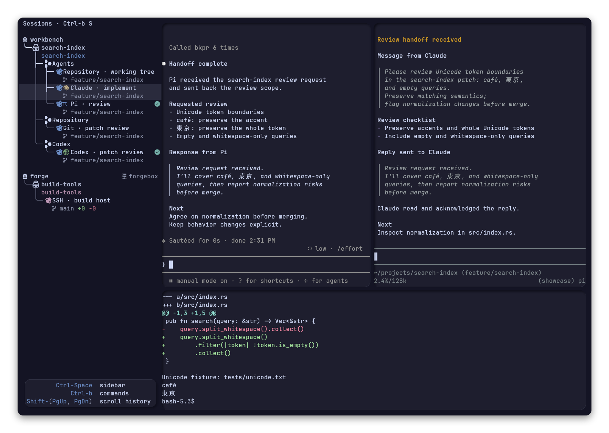

# Bkpr

Bkpr is a native terminal multiplexer for working across projects, machines and
coding agents. Keep shells and native agent UIs in split panes, organize them
into windows and workspaces, and attach to local and SSH sessions from one TUI.

A separate `bkprd` daemon owns the programs. Detaching leaves them running;
reattaching brings you back. Agents keep their own interfaces, with Bkpr adding
project context, native conversation recovery and authenticated peer messaging.



*Scripted demo: Pi and Claude Code exchanging real Bkpr messages, Codex in another
window, and an isolated SSH session. Generated automatically; outer framing is decorative.
[Reproduce the screenshot](docs/reference.md#screenshot-maintenance).*

## Install and start

Distribution is Nix-only. The package includes matching `bkpr` and `bkprd`
executables for x86-64 Linux, ARM64 Linux and ARM64 macOS. Linux has recorded
native runtime acceptance; macOS managed capture isn't runtime-verified.

```sh
# Try it without installing.
nix run --accept-flake-config github:calops/bkpr

# Or install it into your profile.
nix profile install --accept-flake-config github:calops/bkpr
bkpr
```

`--accept-flake-config` accepts the flake's advertised binary-cache settings.
Normal launches use your HOME, shell profiles and current directory. Bkpr doesn't
configure agent accounts, change profiles or approve native trust prompts.

### First workspace

1. Run `bkpr --session work` to start or attach to a named session.
2. Press `Ctrl-b`, then `%` to split left/right, or `"` to split top/bottom.
3. Press `Ctrl-Space` for the sidebar. Use `n` for a new workspace or `N` for a
   separate window. Use arrows and Enter to choose where to work.
4. Press `Ctrl-b`, then `d` to detach. Run `bkpr --session work` to return.

A workspace groups windows and their terminals. A window holds a split layout;
a new window isn't another split. Each attached client chooses its own active
window and focus.

## Work across sessions and machines

Named sessions have independent daemons and saved layouts:

```sh
bkpr --session work
bkpr --session review
bkpr list
bkpr -s work -s review
```

Attach to an **already-running** session on an SSH host, or combine local and
remote sessions in one sidebar:

```sh
bkpr --remote devbox --session work
bkpr -s local:work -s devbox:review
```

Both hosts need matching native builds. Set up the remote session, SSH credentials
and host-key trust first; attachment doesn't install Bkpr or start a missing
remote daemon. OpenSSH host aliases and ProxyJump work normally. Agent forwarding
is off unless you explicitly pass `--forward-agent` to a trusted host.

`bkpr -s work -d` takes over that session's other client attachments without
stopping its programs. `bkpr stop -s work` terminates the selected session and
its programs. In the sidebar, closing a window or workspace also terminates its
owned terminals, including hidden ones. Detach isn't close.

See [remote sessions](docs/reference.md#remote-sessions) for connection options,
reconnect behavior and headless commands.

## Keep agents in their native UIs

Install and authenticate your preferred harness, then launch it inside a Bkpr
pane. Explicit launches avoid relying on PATH wrappers:

```sh
bkpr run claude
bkpr run codex
bkpr run omp
bkpr run opencode
bkpr run pi
```

Managed adapters bind the actual native conversation, expose Bkpr's context and
communication tools, and retain verified conversation IDs for recovery. Arguments
stay native: for example, `bkpr run codex -- resume`.

Managed harnesses are Claude Code, Codex, Omp, OpenCode 2, Pi and Antigravity.
The optional `nix develop .#harnesses` shell supplies pinned native CLIs.

For durable native hooks/plugins, inspect the changes before installing:

```sh
bkpr install claude --dry-run
bkpr install claude
```

Replace `claude` with `codex`, `omp`, `pi`, `opencode` or `agy` as needed.
Run installation on the machine/account where the harness runs. Antigravity
requires this step; the other managed harnesses can use launch-local integration.
Existing approvals and unrelated settings are preserved; installation grants no
tool permissions. `--inspect`, `--update` and `--uninstall` manage the installation.

Cursor Agent, Copilot, Aider, Cline and Goose are recognized but don't have managed
conversation adapters. The [harness reference](docs/reference.md#harness-capture)
covers native modes and the [testing shell](docs/reference.md#harness-testing-shell)
lists pinned versions.

OpenCode 2 uses its private native `--standalone` service. Explicit external-server
and utility/headless modes remain unmanaged; OpenCode 1 is retired. Pi's headless,
ephemeral-session and disabled-MCP/extension modes also remain unmanaged. Other
unsupported native modes pass through without capture rather than silently
changing their configuration.

### Let agents hand work to each other

Launch two supported managed harnesses in the same workspace. Ask one to use its
Bkpr tools to discover its peer and send a task to that exact launch ID. The
recipient can read its inbox, do the work and explicitly acknowledge processing.
`inspect_outbox` lets the sender inspect the resulting receipts.

Messages go through the authenticated broker and native harness integrations,
not simulated terminal typing. Durable acceptance, native wake, inbox read and
processed acknowledgement are separate facts. Discovery defaults to the current
workspace; communication doesn't cross daemons or SSH sessions. Peer messages
are context, not user instructions.

See [agent communication](docs/reference.md#agent-communication) for tool names,
scopes, retention and per-harness notification behavior.

### Return to a conversation

Cold named-session startup restores saved layouts with current shells or verified
active native conversations. It doesn't replay arbitrary old commands.

To inspect saved conversations explicitly:

```sh
bkpr --session work resume
bkpr --session work resume --pane PANE_ID
```

Open the named session first if its daemon is stopped. Recovery uses current
native configuration and approvals, not saved credentials or provider flags.
Missing native state is an error, never a fallback to a fresh conversation.
See [recovery](docs/reference.md#explicit-harness-recovery).

## Essential keys

`Ctrl-b KEY` means press the prefix, release it, then press the key.
`bkpr keys` lists shortcuts; contextual key guides show the active mode's actions.

| Key | Action |
| --- | --- |
| `Ctrl-Space` | Enter sidebar; Esc returns to the application |
| Sidebar `n` / `N` / `r` | New workspace / new window / rename selection |
| Sidebar `x` / Delete | Confirm closing the selected entity and its programs |
| `Ctrl-b %` / `Ctrl-b "` | Split left/right / top/bottom |
| `Ctrl-b` arrows / Tab | Focus neighboring / next pane |
| `Ctrl-b` Shift+arrows | Exchange pane positions |
| `Ctrl-b w` / `W` / `o` | Choose workspace / window / pane |
| `Ctrl-b [` / `]` | Previous / next workspace |
| `Ctrl-b e` | Resize with arrows; Enter or Esc finishes |
| `Ctrl-b s` / Shift+PageUp | Enter scrollback |
| `Ctrl-b /` | Search terminal contents |
| Sidebar `/` | Find panes by metadata |
| `Ctrl-b i` | Inspect the focused pane's local Git/project facts |
| `Ctrl-b g` / `t` | Toggle decorative graphics / choose theme |
| `Ctrl-b d` | Detach without stopping programs |
| `Ctrl-b Ctrl-b` | Send literal Ctrl-b to the live application |

Mouse users can activate sidebar items, drag dividers and select terminal text.
Mouse-aware applications retain their own gestures; host terminals may reserve
selection shortcuts. See [copy and selection](docs/reference.md#selection-and-copy).

## Current limits

- Pre-1.0: native protocol and storage aren't compatibility promises. Upgrades
  don't replace running daemons. Keep matching old binaries for old sessions.
- Layouts and recovery metadata survive daemon restarts. Processes, terminal
  contents and scrollback don't. This isn't process resurrection or a transcript
  archive.
- Managed capture on Linux requires kernel peer-PIDFD support and fails closed
  without it. A recognized harness isn't necessarily bound or ready to receive.
- Rich chrome needs confirmed Kitty graphics and color support. Other hosts use
  text borders. Theme choices are per-client and aren't persisted yet.
- Sessions keep their own workspaces and authority. Cross-session layouts and
  cross-daemon agent discovery aren't implemented. GitHub.com is the supported
  forge; PR/CI/ticket finder filters aren't supported.
- This native implementation replaces the former Zellij version. Old Zellij
  sessions aren't migrated. Release notes through 0.4.2 describe that older product.

## More

- [Full reference](docs/reference.md): CLI, remote access, harnesses, controls,
  clipboard, Git/CI and ownership contracts.
- [Development](docs/reference.md#build): source builds, prerequisites and
  [tests](docs/reference.md#tests).
- [Screenshot maintenance](docs/reference.md#screenshot-maintenance): isolated
  capture recipe, physicalized image and retained evidence.
- [Implementation plan](docs/pane-first-mux/implementation-plan.md),
  [architecture assessment](docs/pane-first-mux/assessment.md) and
  [native runtime evidence](docs/pane-first-mux/engine-proof.md).
- [Changelog](CHANGELOG.md) and [packaging/release policy](docs/reference.md#packaging-and-releases).

MIT; see [LICENSE](LICENSE).
