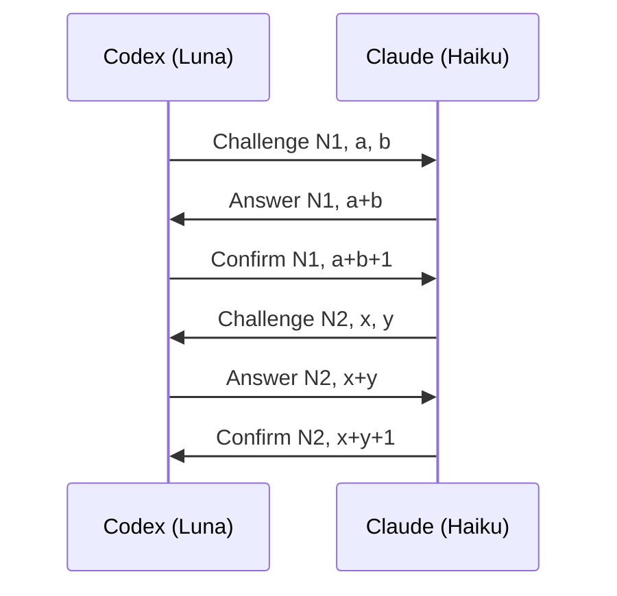

# bkpr

Workspace-first terminals for Zellij, with a sidebar for projects, coding harnesses and GitHub checks.

Zellij owns the terminals, scrollback and live sessions. Bkpr adds workspace grouping, editable names, a pane finder and repository details. Existing Zellij splits and tabs appear in the sidebar too.

## Install and run

With Nix, from this checkout:

```sh
nix run .
nix run . -- --session project
```

To install the command in your profile:

```sh
nix profile install .
bkpr --session project
```

The Nix package includes the native launcher, WASM plugin and Bkpr's Zellij 0.45.1 fork (`zellij 0.45.1-bkpr.6`). Git and GitHub CLI are discovered on the host when available. A Nerd Font is recommended for the sidebar icons. `bkpr --help` lists launch options, including the session name and initial sidebar width.

Cached runtime packages do not require Rust or Cargo. The compiler belongs in the development shell and source builds, not the runtime closure.

Tagged revisions are built for x86_64/aarch64 Linux and aarch64 macOS and uploaded to [bkpr.cachix.org](https://bkpr.cachix.org). The pinned Nixpkgs no longer supports x86_64 macOS. After the `unstable` tag's **Cache tagged packages** workflow succeeds, run it without building Bkpr locally:

```sh
nix run github:calops/bkpr/unstable
```

Nix may prompt once to trust this flake's cache settings; accept to use the substituter. Other dependencies can come from their usual public caches. Moving `unstable` to another commit triggers a cache build unless another tag on that commit already owns the build. After a successful build for a newer tagged commit, CI advances `unstable` to that commit without triggering another workflow run; older or divergent tags leave it unchanged. Maintainers must set the repository Actions secret `CACHIX_AUTH_TOKEN` to a Cachix auth token with write access to the `bkpr` cache; the public key in `flake.nix` is for downloading, not uploading. Untagged commits are not published to this cache.

SemVer `vMAJOR.MINOR.PATCH` tags (including prerelease tags) use the same Nix cache build. Once it succeeds on all supported platforms, GitHub publishes the release notes without uploaded binary assets. Install with `nix run github:calops/bkpr/vMAJOR.MINOR.PATCH` (substitute the actual version). Distro-specific packages may be added later; existing releases retain their historical assets. Tags created by **Tag next release** use its conventional-commit changelog; manually pushed version tags use GitHub-generated notes if they have no changelog entry.

Maintainers use GitHub Actions **Tag next release** → **Run workflow** on `main`. It defaults to **dry run**, showing the proposed version and changelog without writing a tag or building anything; uncheck **dry run** to publish. Conventional `feat:` commits cause a minor bump, `fix:` a patch, and `BREAKING CHANGE:` a major bump; commits without a release-worthy type do not force a new tag. Semantic-release plans the version and notes; publishing updates package versions and `CHANGELOG.md`, atomically pushes the release commit on `main` and its immutable version tag, then explicitly dispatches the tagged Nix cache builds. The single-branch release does not publish semantic-release channel notes, so a separate Git-notes push cannot strand a tagged release without its build. GitHub publishes the release only after all platform builds succeed.

For maintenance-only changes that need a new release, select **release_type: patch**. This requests at least a patch bump without relabeling commits; release-worthy changes still select a larger version when needed. With no commits since the last tag, it does not create a release. Version tags remain immutable even when a build fails: publish a new version instead of moving the failed tag.

To smoke-test release planning and publication locally after `npm ci`, run `node --test .github/scripts/publish-release.test.mjs`. It uses disposable private Git repositories, isolated Git identity/configuration, a local-only transport and a recording `gh` fixture; it cannot push to GitHub or dispatch real builds. It exercises dry runs, a remote that rejects channel notes, atomic tag rejection, immutable-tag collisions and a failed build dispatch. A real dispatch failure remains an error and reports the command to start the build for the already-published tag; never retag that version.

On first launch, click the sidebar and approve its Zellij permission request with `y`. Authorization is cached for the plugin artifact. Bkpr uses a private Zellij configuration; it doesn't replace your personal configuration or start a system service.

Launching the same session attaches to its running terminals and preserves workspace labels. Detaching leaves them running. Closing a terminal terminates it; closing a workspace asks for confirmation before terminating its terminals. Processes need not survive termination of the Zellij server.

### Recovering a closed session

Bkpr keeps a recovery record of each session's workspaces, tabs, splits, pane directories and names, and the native sessions of Claude, omp and Codex panes. It is updated as the session changes, so a crash loses at most a few seconds. To rebuild a session after it was closed or crashed:

```sh
bkpr resume --session project
```

Resume starts a new session with the recorded layout. Each pane opens in its recorded directory (or its nearest existing parent) under its recorded name; names you set yourself stay, others give way to the next title the program sets. Claude, omp and Codex panes open your shell with the resume command (`bkpr run <harness> …`) already typed, so the harness runs as an ordinary shell job: it can be suspended and resumed with `fg`, the command lands in your history, and its exit leaves the shell. Shell startup that discards pending input can drop the typed command. When the command cannot be typed safely (for example, a directory containing spaces), the pane prints it instead for you to run. A harness session that is still open elsewhere, or that Bkpr never captured, comes back as a shell with a short note instead. When the cause can pass (the session is open elsewhere, an old Codex server could not be stopped yet, or the harness exits at once), the pane keeps its recorded session until another harness starts in it or it closes, so a later `bkpr resume` tries again. Other programs come back as a shell. Split sizes, floating panes, scrollback and the original harness flags are not restored. The resumed session keeps updating the same record.

`bkpr resume` refuses while the session is running (attach with `bkpr --session project`) and when there is no record to restore. `bkpr --session project` over a closed session that has a record asks whether to `[r]ecover` it or `[o]verwrite` it with a fresh session; pass `--overwrite` to start fresh without asking. Without an interactive terminal it refuses rather than discard the record. Records live under `$XDG_STATE_HOME/bkpr/sessions` (default `~/.local/state/bkpr/sessions`).

Sessions created before native pane context was introduced remain attachable after upgrading. Bkpr reports the limitation and preserves their startup configuration, plugins and harness wrappers without fabricating context metadata. A fresh session is needed only for the new context features. Invalid or inconsistent existing context metadata remains an error, not a legacy fallback.

Use `bkpr -d --session project` (or `--detach-others`) to attach while disconnecting the session's other clients. This is opt-in: ordinary attachments retain Zellij's shared canvas, which is capped by the smallest attached terminal. Takeover releases a lingering SSH client's size cap without closing panes or restarting programs, even if that client cannot acknowledge its disconnection. It applies only to that attachment, not later tabs or sidebar reloads. Older running servers reject it before detaching anyone; start a fresh session with the updated runtime.

Sidebar width is shared across tabs, including tabs created through stock Zellij controls. Resizing it in one tab updates the others. Narrow windows temporarily clamp the width; growing the window restores the intended size.

### SSH agent forwarding

Panes receive a stable, session-local `SSH_AUTH_SOCK`. Bkpr forwards it to the incoming agent of the most recently attached live Bkpr client, whether launched locally or through SSH. Reattaching updates existing shells; detaching restores the previous client's agent. An unset agent or no attached client never falls back to an unrelated identity.

Attach with `bkpr --session project` to register the current agent. Direct `zellij attach` doesn't update it. Sessions created before this forwarding support need a fresh session so their processes inherit the stable socket.

### Pane context

Every native terminal pane receives context before its program starts, including ordinary shells, stock splits/tabs and direct commands. A harness is not required.

| Variable | Meaning |
| --- | --- |
| `BKPR_SESSION_ID` | Opaque identity of this native session incarnation |
| `BKPR_SESSION_NAME` | Bkpr's user-facing session name |
| `BKPR_WORKSPACE_ID` | Opaque identity of the pane's logical Bkpr workspace |
| `BKPR_WORKSPACE_NAME` | Workspace label when the pane's process started |
| `BKPR_PANE_ID` | Native pane identity, such as `terminal_0` |

These are process-launch snapshots, not mutable shell variables. After moving a pane or renaming its workspace, use `bkpr context --json` for the current session, workspace and pane labels. Grouped tabs share a workspace ID; unrelated tabs do not share one merely because they use the same checkout. A replacement session gets a new ID even when its name is reused. Unmanaged nested Zellij sessions do not inherit the outer session's context.

Existing servers and processes cannot acquire this launch contract retroactively. They remain attachable, but the new context features require a fresh Bkpr session. Live lookup requires the normal Bkpr plugin permission grant and fails closed when its native owner is unavailable.

## Control and automation

The CLI and MCP use the same typed control dispatcher. Start with `bkpr --help`, a command group's `--help`, or `bkpr api help`; `bkpr api schema --operation pane.create` gives an operation's exact JSON arguments. Control commands support `--json` for machine-readable output.

| Command group | Capabilities |
| --- | --- |
| `session` | Discover, inspect, save and stop |
| `client` | Inspect attached clients; explicitly focus, set mode or detach one client |
| `workspace`, `tab` | Create, inspect, rename and close; reorder tabs, control synchronized input and floating visibility |
| `pane` | Create/split, inspect, rename, resize, move directionally within a tab, pin, set borders and close |
| `pane read`, `pane scroll`, `pane clear` | Read viewport/full retained scrollback or a bottom-relative range; scroll and clear an exact terminal |
| `layout` | Export and cycle native swap layouts |
| `agent`, `message` | Discover launches/readiness, launch supported harnesses, set collaboration titles and use authenticated inbox/outbox messaging |
| `terminal-input` | Explicit literal text, bracketed paste, named keys or raw bytes; submission is opt-in |
| `skill`, `completion` | Show/export the bundled control skill and generate shell completions |

For example, inside a Bkpr pane:

```sh
bkpr session list --json
bkpr workspace list --session-scope --json
bkpr pane split --pane terminal_3 --direction right -- /bin/sh
bkpr pane resize --pane terminal_3 --change increase --direction left
bkpr agent launch --harness codex --new-workspace --name review
bkpr pane read --pane terminal_3 --full
bkpr pane read --pane terminal_3 --tail 100 --offset 50
bkpr api schema --operation input.text
```

Replace example pane IDs with identities returned by inspection. Defaults come from the caller's live pane/workspace, not a human client's focus. Outside Bkpr, select `--session SESSION_KEY_OR_ID` explicitly. `session.list` returns the immutable `session_key` and canonical `session_id`; display labels are not selectors.

Creation does not take focus. Client-view changes require an unambiguous client; floating geometry and visibility are shared native tab state. Executable arguments follow `--` and are not shell-interpolated; with `--harness`, they are that harness's arguments instead. Harness recognition, process creation, relay registration and notification readiness are separate observations.

Terminal input can act as the terminal user; it is not a fallback for peer messaging or a way to steer an active agent turn. Receipts distinguish completed, dispatched, failed and unknown outcomes. PTY acceptance does not prove application consumption. Never blindly retry an unknown creation, mutation or input operation.

Pane reads show the viewport by default. `--full` reads all scrollback Zellij still retains; raw CLI output streams without a fixed message-size cap. `--tail N` reads the newest N lines of that retained content; `--offset M` first skips the newest M lines and can also be used alone to read everything older. Blank lines count, zero/past-end ranges are empty, and lines follow the native text dump. `--ansi` preserves native styling sequences. The MCP operation `pane.read` takes the same `full`, `tail`, `offset` and `ansi` arguments; oversized encoded MCP results fail explicitly instead of being truncated, so request a smaller range.

Control reuses the pinned runtime's existing CLI and plugin APIs; no new Zellij control protocol or fork update is required. SDK-only operations need the matching Bkpr plugin and normal permission grants. Existing sessions remain attachable; a session running an older plugin may need a fresh session for the new plugin endpoint. Client-specific focus rejects floating/fullscreen cases and a target tab currently viewed by another client, because baseline stack/floating behavior can change shared focus. Focus into an unshared target tab remains available. Paste plus submission uses two ordered native actions, not an atomic transaction.

Headless session creation, live session-label rename, arbitrary pairwise pane swaps, inactive-tab layout application and live pane watching are deferred in [TODO.md](TODO.md), along with the associated native bugs. Cross-tab/workspace movement, float/embed transitions and target-pane fullscreen are also deferred because of baseline SDK targeting/focus limitations. Floating creation, geometry and safe pin/border controls remain available. Deferred features are not exposed as placeholder commands.

`bkpr skill show` prints the bundled skill; `bkpr skill export PATH` explicitly writes its `SKILL.md` and reference files without overwriting existing files. No persistent harness profile is changed. Supported interactive Claude launches load it through a private launch-local plugin, and Omp loads it alongside its temporary extension. Codex uses MCP initialization instructions and read-only resources instead; automatic Codex skill installation is not claimed.

## Workspaces and navigation

Every fresh launch, attachment and recovered session starts that client in Zellij's **Locked** mode, so terminal shortcuts go to the application. Reattaching does not restore an earlier unlocked mode or change another attached client's mode. Press **Ctrl+Space** to focus the sidebar, or **Ctrl+g** to unlock stock Zellij controls. The rounded shortcut guide follows the current mode and effective keybindings: it stays inside the sidebar when all keys and descriptions fit without wrapping, and otherwise expands into the pane area. A widened sidebar guide stays adjacent to the sidebar instead of moving to the far-right edge. Its border becomes bold terminal-yellow whenever unlocked, including native submodes, and returns to subdued styling when Locked.

Locked is only the client's initial mode; Normal remains the base mode, so sidebar keys and ordinary application typing still work after unlocking. Attachment overrides a legacy session's saved base mode for the new client without rewriting its configuration or changing other clients.

A left click activates a workspace or terminal without moving keyboard focus into the sidebar. Hover highlights a row and opens its details; moving into the popup keeps it open, and leaving both closes it. Sidebar focus opens the selected row's details automatically, and keyboard navigation follows the selection. Right click has no special popup behavior. Details include available activity, CWD, repository, pull request and checks, with clickable links.

Moving or closing details repaints only the exposed terminal cells. Moving the pointer within an unchanged popup does not redraw it; refresh-button hover styling still updates. Cursorless sidebar controls and passive cards preserve the last input-cursor position, including hidden cursors, so terminal cursor trails do not jump between paint regions. Rename dialogs and focused overlays retain their own input cursors.

The first sidebar line centers the beekeeper icon and project name. Workspaces and terminals use dot markers; recognized harnesses keep their separate identity icons beside their names. Item rows keep a left gutter for the hover outline and use the rightmost sidebar column.

Each sidebar-created terminal opens in its own native tab, grouped under its workspace. Stock splits remain available. Drag the separator to resize the sidebar, or use Zellij's resize mode. New sidebar-created tabs inherit the current width, folds and scroll position while their live state arrives.

The pane finder and **n / N** creation prompts use centered, titled, bordered overlays. Workspace creation accepts an optional name and working directory; terminal creation keeps the selected workspace and accepts an optional directory. **Tab** switches workspace fields, **Ctrl+u** clears the current field, and **Esc** cancels before creation is dispatched. Once dispatched, creation waits for its result; an error keeps the form available for correction and retry.

Focused overlays dim surrounding terminal text using terminal-native faint styling. Raster-image pixels are unchanged. Overlays are local to the client that opened them; other clients keep their focus and undimmed view. Passive details and shortcut cards do not dim the UI. These overlays require a fresh native session; existing sessions remain attachable with their retained UI.

| Context | Key | Action |
| --- | --- | --- |
| Application | Ctrl+Space | Focus sidebar controls |
| Sidebar controls | Ctrl+Space / Esc | Return to the application in Locked mode |
| Any mode | Ctrl+g | Toggle Locked mode |
| Unlocked | Ctrl+p, then r / d | Split right / below |
| Unlocked | Ctrl+t, then n | Create a native tab |
| Unlocked | Alt+arrows | Move pane focus; left/right cross tabs at the edges |
| Sidebar controls | Tab / Shift+Tab | Cycle pane focus |
| Sidebar controls | Ctrl+d / Ctrl+q | Detach / quit the session |
| Sidebar | arrows / j / k | Select a row |
| Sidebar | Enter | Activate the selected terminal |
| Sidebar | Space | Fold or unfold a workspace |
| Sidebar | n / N | Create a workspace / terminal in the selected workspace |
| Sidebar | r / x | Rename / confirm termination |
| Sidebar | / | Open the pane finder |
| Dialog | Tab / Ctrl+u | Switch fields / clear the current field |
| Dialog | Enter / Esc | Submit / cancel |

Double click a workspace group to fold or unfold it. Stock resize, move, scroll and session modes remain available after unlocking.

### Pane finder

Press **Ctrl+Space**, then **/** to open a centered, whole-window finder. Search pane metadata without switching terminals. The selected match shows the same details as its context popup. The finder belongs to the opening client; replicas on other attached clients cannot focus, hide or close it.

Results underline matching text in blue and keep their project's sidebar color. Metadata-only matches include a short excerpt. Finder key hints appear in the sidebar.

Plain text searches across metadata. Add filters to narrow the results:

```text
project:bkpr branch:main
harness:claude status:working
workspace:"client work" ci:failed
pr:123 ticket:ENG-42
cwd:"/home/me/projects"
```

Supported filters are `pr:`, `branch:`, `project:`, `workspace:`, `harness:`, `status:`, `ci:`, `cwd:` and `ticket:`. Terms combine with AND; quote values that contain spaces. Use arrows or **Ctrl+n / Ctrl+p** to select a match, **Enter** to activate it and **Esc** to cancel. Search uses collected metadata, not terminal screen scraping or a remote request per keystroke.

The preview links the PR number next to the repository path, followed by its title and any verified Linear ticket. Links are clickable; other actions, including CI refresh, remain in the context popup. Bkpr doesn't change Linear or harness profiles to provide these links.

## Repository and CI details

Solid project dots identify repositories. Colors are assigned across the whole session, not separately per workspace: the same canonical repository shares a color across linked worktrees and workspaces, while different repositories receive distinct available colors. Existing assignments survive branch changes, pane moves, metadata refreshes and owner recovery. Closing a repository's last pane frees its slot without recoloring the others.

Limited terminals use twelve chromatic ANSI colors. With query-confirmed truecolor, Bkpr deduplicates known identical palette entries and derives additional shades from your terminal's own colors. If the available palette is exhausted, additional repositories stay muted rather than receiving a duplicate assigned color.

The second line follows the foreground program's actual CWD and shows its branch, available whole-branch additions/deletions and an independent CI badge. Outside Git, it shows the program description instead. Collapsed workspaces summarize their harness and CI state.

Branch totals compare committed `HEAD` with its merge-base, not uncommitted changes or the base branch's current tip. They cover the whole repository, including when the foreground CWD is nested. When a PR is associated, its target commit is authoritative, including stacked PRs. Otherwise, local Git configuration and refs choose the base. Bkpr never fetches automatically: a known target missing locally makes totals unavailable rather than falling back to main.

GitHub CI monitoring runs `gh` from the item's canonical working directory, including nested directories rather than substituting the repository root. This preserves directory-dependent wrappers and authentication configuration. Run `gh auth login` in that directory if needed. Bkpr doesn't switch accounts, override `GH_CONFIG_DIR`, or edit credentials. Monitoring requires an explicit `github.com` HTTPS/SSH remote and a current commit; GitHub Enterprise and SSH aliases aren't supported.

First loads query GitHub eagerly. Panes in the same canonical CWD share requests and results; batching stays within that directory so separate directories and worktrees can use different authentication contexts. Requests remain spaced at least two seconds apart per session, with shared backoff and provider limits. Checks refresh every 60 seconds while pending, running or unresolved. Complete results stop refreshing, including failed, cancelled, passed and skipped checks; no checks and missing remote branches also stay idle. Git metadata events invalidate results after local commits, ref changes and pushes. Transport failures use bounded backoff, and provider rate limits remain authoritative. Use refresh for remote changes without a local ref event, same-commit reruns, newly added checks or PR-state changes. If refresh observes checks running again, automatic checking resumes until they finish.

For named branches, checks belong to the latest commit of the corresponding remote branch, selected from the configured push/upstream relationship. GitHub resolves that tip without a Git fetch. The popup labels the checked remote ref and commit and notes when local `HEAD` differs; passing remote checks never imply that unpushed local work was tested. A missing remote branch is unavailable, not a reason to substitute main. Detached HEADs use exact-commit lookup.

Refreshing cached results is a loading/stale state, not an error. Real provider failures remain visible until a successful response replaces them.

Results persist per canonical CWD under `$XDG_STATE_HOME/bkpr/projects` (default `~/.local/state/bkpr/projects`). Repository, local branch, local commit, selected remote target and Git refs must still match before restoring them. The checked commit is retained independently of local `HEAD`. Unchanged complete results need no request after restart, including failures and cancellations; unfinished or unresolved results appear immediately from cache and resume checking.

Open PR links follow the branch even while local commits are unpushed. Linear associations come from canonical issue links in the PR's first ten rendered comments, without workspace-specific mappings, Linear credentials or configuration.

## Colors

The sidebar, finder, shortcut cards and details popups use the terminal's foreground/background and standard ANSI palette, not a bundled RGB theme. Selection and hover also remain usable when only standard colors are available.

When the native host confirms truecolor support and reports the terminal's actual colors, Bkpr derives muted text, softened accents and selection shades from that palette. Surface backgrounds shift away from the foreground's luminance: darker on dark themes and lighter on light themes, using the same calculation. The application's background is unchanged. Unknown colors or capabilities retain native ANSI styles rather than guessed RGB values. Older native hosts without palette metadata use that fallback; derived shading requires a host publishing `bkpr_terminal_colors`.

There are no Bkpr-specific color configuration options yet; configure your terminal palette normally.

## Clipboard

Bkpr forwards terminal clipboard requests over the terminal connection, including MIME/image access through Kitty's OSC 5522 protocol. Over SSH, this accesses the client terminal's clipboard; X11 forwarding is not needed. Images require support from both the terminal and the application.

In Kitty, use its terminal paste shortcut (`Ctrl+Shift+V`) to send images to an application that supports enhanced paste. This differs from an application's own clipboard shortcut: Omp 18.12.2's `Ctrl+V` reads the clipboard on the machine running Omp, which is normally unavailable over headless SSH.

Bkpr enables clipboard-query forwarding in its private Zellij session, so programs in that session can request clipboard contents. The host terminal's clipboard permissions still apply; Bkpr doesn't change your terminal settings or personal Zellij configuration. MIME paste notifications retain their originating pane and client, and their permission tokens are scoped to one clipboard selection and one use.

Use a fresh session after upgrading the native runtime; already-running servers keep their old code.

## Coding harnesses

Recognition and semantic status are separate. Bkpr recognizes Claude Code, Codex, OpenCode, omp, Antigravity, Cursor Agent, GitHub Copilot CLI, Aider, Cline CLI and Goose. Recognition supplies identity and available titles, not an invented working or idle state.

Harness status comes from native **OSC 7501** reports. Titles, progress bars, notifications and rendered terminal text aren't substitutes. Non-reporting harnesses remain **unknown**. Ordinary programs have no harness-status badge, even if they emit generic program-status reports; their Git and CI details still work.

Reported **working** status uses a twelve-position clockwise clock animation in the sidebar, details popups and finder previews. Animation runs only for visible working badges and stops when the status changes or the surface is hidden.

The upstream capabilities below were checked on **2026-10-14**:

| Harness | Semantic reporting |
| --- | --- |
| Claude Code | Native OSC 7501 since [2.1.295](https://github.com/anthropics/claude-code/releases/tag/v2.1.295) |
| Codex | Available in [0.163.0-alpha.12](https://github.com/openai/codex/releases/tag/rust-v0.163.0-alpha.12), not the checked stable 0.162.1 |
| omp | Native OSC 7501 since [18.8.7](https://github.com/can1357/oh-my-pi/releases/tag/v18.8.7); `terminal.programStatus` defaults to enabled |
| OpenCode | [OSC 7501 PR](https://github.com/anomalyco/opencode/pull/54560); not released at the checked date |
| Antigravity, Cursor, Copilot, Aider, Cline, Goose | Recognition only; no native OSC 7501 producer established at the checked date |

An alpha release isn't stable availability, and an open PR isn't a release commitment. Upstream Pi isn't omp.

### Explicit harness launch

Use `bkpr run` to select Bkpr's launch integration explicitly, without relying on its session-local `PATH` wrappers:

```sh
bkpr run claude
bkpr run codex --model gpt-6-luna
bkpr run omp
bkpr run opencode
```

Supported names are `claude`, `codex`, `omp`, `opencode`, `agy`, `cursor`, `copilot`, `aider`, `cline` and `goose`. Aliases include `claude-code`, `antigravity`, `cursor-agent`, `copilot-cli`, `github-copilot` and `.cline`. Unknown names are rejected. Claude, Codex and omp use the same launch-local integrations as their wrappers; the others execute their installed CLI directly without acquiring a parent agent's messaging identity.

Arguments after the harness name belong to that harness. An initial `--` separates Bkpr's arguments; later `--` arguments are preserved. Executables are resolved from `PATH` while skipping Bkpr-managed wrappers and their aliases. The command works outside Bkpr too, but workspace/session-scoped messaging still requires a managed pane's live context. Automatic session-local wrappers remain enabled.

### Claude Code

Run an up-to-date `claude` directly in a Bkpr terminal. Native reports supply lifecycle state, attention and available activity messages.

For working activity text with Claude 2.1.296, opt into its [fullscreen renderer](https://code.claude.com/docs/en/fullscreen) for that launch:

```sh
claude --settings '{"tui":"fullscreen"}'
```

This research-preview renderer handles conversation scrollback and selection inside Claude. Activity describes current work, not necessarily the original task. Successful completion can emit `done` without a summary, so the activity description clears.

Bkpr adds a launch-local title hook for supported interactive `claude` invocations. It supplies a first-prompt fallback label without replacing later native titles or explicit Bkpr renames. Resume/continue and noninteractive invocations do not receive this title hook. Aliases, shell functions and absolute executable paths can bypass the wrapper. `CLAUDE_CODE_DISABLE_TERMINAL_TITLE=1` disables title supplementation. The hook doesn't change global settings, credentials, permission policy or semantic status.

### Other harnesses

Run `omp` directly with version 18.8.7 or newer and native program status enabled. Semantic status still comes from omp's native reports, not Bkpr's communication adapter.

Antigravity is recognition-only. Bkpr doesn't wrap `agy`/`antigravity`, install callbacks, edit settings or redirect its profile. Other recognition-only harnesses also need native semantic reports before their status can be shown.

### Agent communication (experimental)

Fresh Bkpr sessions supply launch-local wrappers for `claude`, `omp` and `codex`. Each supported interactive launch receives its own authenticated agent ID and a Bkpr MCP server without changing user-level harness settings. Messages go through a relay broker, a shared background process that starts on demand and keeps running after the session that started it closes; finding it still running after every session has closed is expected. The seven messaging tools remain `whoami`, `discover_agents`, `send_message`, `read_inbox`, `ack_message`, `inspect_outbox` and `set_title`.

Two additional tools expose control without adding a tool for every operation: `control` handles inspection, lifecycle, layout, geometry and process execution; `terminal_input` handles only explicit `input.*` operations. Both accept `{"operation":"...","arguments":{...}}`. Start with `control` operation `api.help`, then `api.schema` for the chosen operation. The read-only resources `bkpr://control/skill` and `bkpr://control/reference` provide the bundled guidance; resource exposure does not guarantee a host will load it automatically. Normal tool approvals remain in effect.

Discovery returns peers only, excluding the caller. Its default `scope: "workspace"` uses current native Bkpr workspace membership, not CWD or Git grouping. `scope: "session"` includes other workspaces in the same Bkpr session; `"repository"` explicitly uses the canonical Git worktree or canonical launch directory outside Git; `"all"` includes other active launches. Unknown workspace/session context is an error, never a fallback to repository scope.

`whoami` and peer records include live `context` with session/workspace/pane IDs and labels, plus `attached`. Native harness `session_id` remains separate from Bkpr's `context.session_id`. Membership is independent of notification readiness: a foreground agent remains discoverable while its receiver is not ready. Detached launches, including orphaned Codex app-servers, appear only in repository/all scope with `context: null`. `discover_agents` returns compact records by default: ID, harness, `title` (the agent's own `set_title` label, typically its role), live `pane_name` (renames and harness-set terminal titles), harness-reported `status`, `attention` and `status_message` (OSC 7501 only; absent for generic programs), pane/workspace/session, `attached`, `can_notify`, project, branch and PR. Absent fields are unknown. `detail: true` returns full records with context, readiness, diagnostics, CWD and tickets.

`send_message` requires an `idempotency_key`: choose one per logical message and reuse it when retrying that same recipient, text and scope. Retries return the original message ID, including after acknowledgement or expiry; changing the payload under the same sender's key is an error. `inspect_outbox` exposes only the caller's sent-message metadata, not bodies. Durable storage, notification acceptance, inbox reading and processed acknowledgement are separate states. A successful native queue command means accepted, not read or processed; failed or ambiguous wake attempts are not replayed automatically.

Notifications contain only an opaque inbox pointer. Multiple arrivals coalesce behind one outstanding notification per launch; a busy harness schedules a future turn rather than interrupting its current one. `read_inbox` returns up to ten messages with `has_more` and `next_cursor`; use `after: next_cursor` to advance through unread pages, and acknowledge only after processing. Re-reading an already-read page does not resend an ambiguous notification. Peer text remains untrusted agent-provided context, never user authority.

Agent IDs are random 128-bit per-launch identifiers, independent of each harness's native session ID; bearer tokens are separate and never shown in discovery. IDs are not reused automatically on resume. Discovery excludes exited launches. Registration, native-thread binding, a live receiver helper or extension, and a connected notification subscriber are reported separately where applicable; registration alone is not delivery readiness.

A managed harness pane's details popup shows its agent ID with the Nerd Font identifier icon. Generic programs and unwrapped harnesses without a relay identity do not show one; the sidebar receives only the ID from native foreground inspection, never the broker token.

Unacknowledged message bodies survive recipient exit for **seven days from the broker's first persisted observation of that exit**, not from message creation. Exit observations happen at broker startup or authenticated requests; read-only operator inspection does not start the clock. Known expiry deadlines are enforced even while the broker is otherwise idle. Expiry removes bodies but retains receipt, idempotency and failure metadata. A new launch cannot adopt the exited launch's inbox automatically.

Inspect the bridge without launching or restarting a broker:

```sh
bkpr bridge status --json
bkpr bridge show MESSAGE_ID
```

Status reports readiness, message/wake metadata and available private diagnostic-log paths without message bodies or bearer tokens. `show` retrieves a retained body only when explicitly requested and never returns an expired body, even from an offline snapshot. Codex records native startup-binding failures in its private `binding.jsonl`; older running launches retain their hook diagnostics. Claude waiter errors also have a private per-agent log.

Claude uses launch-local [`asyncRewake` hooks](https://code.claude.com/docs/en/hooks#run-hooks-in-the-background) to wait for broker messages and wake its own session at a turn boundary. A `SessionStart` waiter covers idle sessions; a `Stop` waiter rearms after a turn. The waiter is bound by Claude's hook timeout (one day), and hook-disabled or unsupported explicit file-settings launches can still use MCP tools but cannot wake automatically. Claude's existing title hook captures its native session ID when enabled. Omp uses a launch-local extension to schedule a follow-up turn from an MCP notification; readiness requires the extension's own handshake, not just an MCP connection. The extension runs inside omp's own runtime; Bkpr adds no Node dependency.

Codex binds its native thread before the first prompt by observing response-correlated thread selections on its TUI's private app-server connection. Fresh sessions, explicit resume/fork and picker selections bind the conversation Codex actually selected, not a guessed latest thread or an auxiliary title-generation thread. No synthetic startup turn is sent, and no Bkpr `SessionStart` hook approval is needed for new launches. Native user hooks, trust and tool approvals remain unchanged.

Codex uses its native remote queue after binding. The managed app-server remains necessary with the tested Codex 0.163.0: launch-local MCP `-c` overrides force embedded mode, where a stock queue can exit successfully without waking the active TUI. These mechanisms do not type into a user's input field or steer an active turn; Codex's queue nevertheless presents a broker inbox pointer as internal user-role input.

Codex sees a stable MCP server named `bkpr`; agent IDs and bearer tokens still change for each launch. Bkpr leaves normal tool approvals in place and does not modify persistent Codex configuration. With tested Codex 0.163.0, “Always allow” for a launch-only MCP server is remembered only within that session: durable approval requires the same server to be defined in a persistent user/project config. The stable name removes identity churn, but prompts can still recur on fresh launches.

Codex may expose its launch-local endpoint as a symlink into its daemon socket directory. Bkpr accepts that indirection only when the endpoint is user-owned, both endpoint directories are private and user-owned, and the resolved target is a user-owned Unix socket. Missing targets, link loops and ordinary files are rejected.

Bkpr uses one private MCP JSON file per managed session (`0700` directory, `0600` file), shared by its Claude launches through `--mcp-config`. The file contains only the Bkpr executable path and MCP command; each launch receives its own authenticated agent ID and token through its environment. This supplements rather than edits the user's MCP configuration. No development-channel flag or persistent Claude registration is required.

Codex's dedicated native app-server outlives its terminal so its queue remains available. It prints a private manifest location and an exact `bkpr codex-stop --manifest <path>` command. Acknowledge all pending messages before stopping it; Bkpr refuses to stop a server with unread messages. Omp's temporary extension package is removed on normal exit, but forced termination can leave its private package in the managed session runtime.

Codex keeps a single writable owner for a conversation. If a new launch's resume reports that the conversation is open in another app, finish pending work and explicitly stop its previous queue server with the printed command before retrying. Bkpr does not steal the conversation or terminate the previous owner automatically.

Session-local wrappers are found through `PATH`; `bkpr run` provides the explicit alternative. Already-running processes and sessions created before these wrappers are installed do not gain them retroactively. Interactive consent and trust requirements cannot be bypassed by Bkpr. Codex noninteractive `exec` and `review` do not support this native remote queue and fail clearly instead of silently claiming message delivery.

The broker wire protocol is version 3. New clients fail clearly against older brokers rather than applying the old repository-based meaning of “workspace.” Running brokers are never replaced automatically; inspect their pending work before explicitly restarting them and relaunching managed harnesses. Retained messages and idempotency receipts preserve their original scope during migration.

## Develop

The Rust workspace contains the native launcher/metadata helper in `crates/bkpr` and the WASI sidebar/plugin in `crates/bkpr-zellij`. Zellij owns application PTYs; a session-wide plugin owns workspace metadata, with one native helper for Git and shared CI requests.

Automatic releases remain in **0.x**. Breaking changes increment the minor version; the publisher rejects any computed nonzero major before changing release metadata or tags. A move to 1.0 requires a deliberate release-policy update.

Use the devshell and incremental Cargo builds for iteration. The shell supplies the pinned [Bkpr Zellij fork](https://github.com/calops/bkpr-zellij/tree/main); no local patch application or native runtime build is needed for ordinary Bkpr development.

```sh
nix develop
just build
just run --session dev
```

`just build` builds the debug launcher and WASI plugin together. `just run` performs that build before launching and selects the plugin from the same Cargo target directory, rather than reusing an unrelated `BKPR_PLUGIN` override. It forwards Bkpr arguments unchanged, including quoted session names and `--zellij` / `--plugin` overrides. `just` lists the available commands. Plain `cargo run` still works, but builds only the launcher; rebuild the WASI plugin separately when using it.

The devshell supplies `just` and the pinned fork runtime. Retain `target/` for incremental builds; do not use `nix build` for the edit/run loop. `CARGO_TARGET_DIR` is respected for both builds and plugin selection. When changing Zellij itself, use the fork's devshell and Cargo, then run `just run --zellij ../bkpr-zellij/target/debug/zellij`. Start a fresh session to use native changes; existing servers keep their original code.

```sh
# In the devshell:
cargo test --locked --workspace
cargo clippy --locked --workspace --all-targets -- -D warnings
cargo clippy --locked -p bkpr-zellij --target wasm32-wasip1 -- -D warnings

# Packaging validation, not the inner development loop:
nix build .#bkpr
```

`bkpr-native` and `bkpr-zellij` are also exposed as separate Nix package outputs. Development overrides are `BKPR_ZELLIJ` / `--zellij` and `BKPR_PLUGIN` / `--plugin`. The fork exposes its own native package and devshell; Bkpr's release CI builds and caches the pinned dependency. Stable maintenance contracts and the native feature-branch workflow are in [AGENTS.md](AGENTS.md).

The native fork's default [`main`](https://github.com/calops/bkpr-zellij/tree/main) contains the Bkpr integration history. Retained `feature/*` branches submit PRs into `main`; there is no separate `bkpr` or permanent upstream branch. Bkpr consumes `github:calops/bkpr-zellij/main`, locks its revision, and preserves the fork's own dependency pins without `follows` overrides.

The fork checks stable Zellij releases daily and opens `update/zellij-vX.Y.Z` PRs from release tags, not upstream's moving `main`. Upstream ancestry is preserved through merge commits. All PRs require human validation and explicit manual merging. Ordinary feature PRs use local/integration verification; only release-update PRs run the fork's Nix/package checks. Protected `main` requires PRs but no global CI status or mandatory approval count; auto-merge, squash merging and rebase merging are disabled.

### Live agent communication check

`tests/live_bridge.py` launches real interactive Codex (`gpt-6-luna`) and Claude (`haiku`) panes in one fresh Bkpr workspace under a headless PTY. It uses your existing harness login/configuration and creates ordinary new conversations. Bkpr, Zellij sockets and broker state are isolated; the runner does not edit provider settings or credentials, bypass trust, or attach to existing sessions. The current runner requires Linux pidfds and Python 3.11 or newer.

From the devshell, with the native launcher and WASM built:

```sh
# Check paths, versions and requested models without making model requests.
python3 tests/live_bridge.py

# Real provider requests and normal billing apply.
python3 tests/live_bridge.py --run

# Handle normal login, workspace, hook or MCP consent yourself if needed.
python3 tests/live_bridge.py --run --interactive --timeout 600
```

`--workspace` selects an existing trusted checkout (default: the current directory). `--harness-home` selects the normal provider configuration home; explicit provider configuration environment variables remain authoritative. `--bkpr`, `--zellij` and `--plugin` select built artifacts; for fork development, use `--zellij ../bkpr-zellij/target/debug/zellij`. Each run prints an attachment command for its private native session. The runner waits for the ordinary Bkpr plugin permission grant and verified live context before starting paid harness launches. Use `--interactive` or the printed attachment command to approve it; the runner does not fabricate or copy permission grants.

Each harness bootstraps its own discoverable identity, then the driver supplies one ordinary future-turn Codex kickoff. The harnesses perform every peer send themselves:



Only the originating harness's initial prompt contains each nonce. Incoming messages must be retrieved through `read_inbox` and acknowledged after processing. Claude gets a launch-local Bkpr tool permission allowlist and built-in tool denials. Codex uses its normal read-only sandbox and approval policy; its prohibition on other tools is prompt-enforced, not a technical MCP-only allowlist.

A run passes only when the private broker's durable receipts prove all six exact payload/key hashes, the correct sender/recipient identities, increasing causal sequence, a predecessor read before its dependent response, and processed acknowledgements for every message, with no extra sends. Queue acceptance or terminal text alone cannot pass it. The runner does not inject peer messages, steer active turns, or wait for a provider success string.

`--run` exits zero only on success, including cleanup. Failures are not skipped: hook errors and missing readiness fail the check. Protected evidence is retained under `target/smoke/live-bridge/<run>/`: `result.json`, `readiness.json`, progress receipts when available, terminal output, and available Codex server/hook logs. The scenario deadline includes startup and model turns; owned-process cleanup uses separate bounded waits. No raw broker state or bearer-token manifest is copied into evidence.

The deterministic verifier can be checked without providers:

```sh
python3 -m unittest discover -s tests -p 'test_live_bridge.py'
```


## Limitations

- No built-in remote connection manager or saved-machine profiles. Run Bkpr on a remote host through SSH as usual.
- Live Git watching requires Linux inotify and pidfd support (kernel 5.3+). Nix packages are exposed for Linux and Darwin, but that doesn't imply equivalent runtime coverage.
- Unicode names work through paste. Typed non-Latin dialog input is constrained by the pinned Zellij plugin key decoder.
- Notification passthrough isn't implemented.
- Semantic coverage depends on each harness's actual native producer. No transcript parsing is provided. Harnesses are resumed only by an explicit `bkpr resume`, and only from session IDs they reported themselves.
