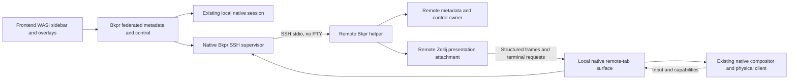

# Remote workspaces

Status: proposed design, 2026-10-29. No remote-workspace implementation is claimed by this document.

Implementation plan: [remote-workspaces-plan.md](remote-workspaces-plan.md).

## Intent and agreed constraints

Present local and remote workspaces together in Bkpr's existing sidebar. Selecting a remote workspace displays terminals owned by a Zellij session on that host. The remote server continues running programs when the frontend disconnects.

The user has agreed to these boundaries:

- One displayed tab has exactly one owning Zellij session. Application panes from different sessions or machines never share a tab.
- The backend owns its tabs, pane layout, PTYs, scrollback and programs. The frontend proxies interaction; it does not reconstruct that layout locally.
- Remote content excludes the backend's Bkpr sidebar. There is one common frontend sidebar.
- Fork changes are allowed. Prefer new, isolated modules and narrow opt-in hooks over changes spread through upstream internals, so stable Zellij releases remain mergeable.

A session can contain several tabs and workspaces. The constraint is not one session per tab: several frontend tab bindings may refer to different tabs of the same backend session.

## Scope

The deliverable includes host enrollment, session discovery/explicit attachment and creation, mixed sidebar navigation, remote workspace/pane operations, remote metadata, full interactive presentation, disconnect/reconnect and safe view persistence. Existing local behavior remains supported.

Non-goals:

- Mixing backend ownership within a tab, moving a live pane between machines, or migrating processes/layout ownership to the frontend.
- Replacing Zellij, adding a cloud service, or requiring its HTTP/web-sharing server.
- Treating a nested `ssh ... zellij attach` terminal as native remote-workspace integration.
- Transferring credentials, editing SSH configuration, automatically installing/upgrading software, or restarting an incompatible live backend.
- Cross-host agent-broker federation. Existing communication within a remote workspace continues on that host; connecting a host does not merge agent trust domains.
- Persistent terminal transcripts, file synchronization/upload, a new editor, or a command-palette dependency.

## Current foundations and missing capabilities

| Area | Current evidence | Required change |
| --- | --- | --- |
| Sidebar model | `crates/bkpr/src/lib.rs`: `Snapshot` has one session, owner instance and revision; pane/tab IDs are scoped to that session. | A qualified presentation model combining independent backend snapshots, without inventing a shared revision or local identities for remote panes. |
| Control | `crates/bkpr/src/control/native.rs`: `Native::resolve` validates local context; commands target one runtime session. | Explicit endpoint routing to the owning host before existing typed operations execute. |
| Metadata/context | `context_contract.rs`, `native.rs`: native-owner publications and live membership are authoritative. | Export a public, credential-free projection over the authenticated connection. Do not export private owner publications. |
| Client transport | Fork `zellij-client/src/remote_attach/` is HTTP-authenticated terminal/control WebSockets; the remote loop writes rendered terminal bytes. | SSH stdio transport and a native presentation attachment; the existing web path is not the composition API. |
| Rendering | Fork `zellij-server/src/output/mod.rs`: `Output` collects character/image chunks before ANSI serialization. | An opt-in structured presentation export/import boundary, with native clipping, composition and resource ownership. |
| Ordinary native IPC | Fork `zellij-utils/src/ipc.rs` carries input, render strings, terminal queries and capability updates. | Reuse its semantic operations where possible, but do not mistake a raw IPC tunnel for embedded presentation. |

The sibling checkout also contains uncommitted client-owned floating-surface and resize-feedback changes. Those are useful integration evidence, not a landed prerequisite. They do not establish a tiled-sidebar-free remote viewport or a general remote render protocol.

## Proposed architecture

Use a local native **remote-tab surface**, backed by an authenticated presentation attachment to the owning server. Keep the current local path unchanged. Remote tabs contain frontend chrome plus one backend-content surface, not local terminal proxies for every remote pane.

Diagram arrows describe ownership/data paths, not separate network connections. Frames never travel through WASI. WASI receives only bounded metadata, connection status and ordinary action results. The native compositor remains the only physical-terminal writer for an attached frontend client.

The frontend has local native tab/view handles for selection and chrome. They are presentation handles, not backend application-pane identities. A remote tab cannot acquire a local shell through stock split/new-pane/run actions: those operations route to its owner or fail explicitly before local execution.

Another session on the local host uses the same external-session presentation contract over private local IPC, without SSH. The frontend's own local tabs keep the existing direct path. Thus federation covers several local sessions as well as remote ones without replacing ordinary local rendering.

### Native presentation boundary

Preferred design: export the backend's final client-filtered scene before terminal ANSI serialization, then compose that scene in the frontend's content rectangle. It carries resolved text/style runs, cursor state, damage/full-frame metadata, hyperlink definitions and image resources/placements. It does not expose private Rust object layouts, `Rc` references, source-local hyperlink indices or raw image-store pointers.

This is a new negotiated contract, not an existing native facility. A feasibility spike must prove the export and import locations before the hook inventory is accepted. Importing terminal escape strings and rewriting cursor coordinates, parsing a second VT grid, and sending `pane read` snapshots are rejected alternatives.

Backend terminal operations that are not drawing, such as clipboard requests or host queries, use a separate typed request/reply path. Arbitrary pre/post ANSI strings must not become a remote escape hatch around the compositor.

Treat received scenes as untrusted display data even over authenticated SSH. Validate coordinates, dimensions, glyph/control-character encoding, styles, links and image/decompression budgets before importing them. Remote scene content cannot emit arbitrary terminal escapes, paint outside its surface, mutate local state or dispatch frontend actions. Malformed scenes fail that view without disrupting local tabs.

The wire needs the following semantic messages. Exact tags, encoding and limits are fixed after the feasibility measurements, before implementation consumers are written:

| Message | Required content |
| --- | --- |
| `Hello` / `Capabilities` | Version family, required features, bounded decoding limits and authenticated endpoint/session incarnation. |
| `AttachView` / `ViewReady` | Stable view ID, fresh connection epoch, exact backend tab, declared chrome policy, client palette/capabilities and effective geometry. |
| `Frame` / `FrameAck` | View/connection/geometry epochs, sequence/base sequence, full or delta scene, damage, resolved text/styles/links, cursor and resource references. |
| `Resource` / `ResourceRelease` | Bounded image payload chunks and source-scoped resource lifecycle; no physical-terminal IDs or arbitrary ANSI. |
| `Input` / `Action` / `Result` | Exact view/target, ordered input sequence or request ID, typed operation and backend acceptance/completion outcome. |
| `TerminalRequest` / `TerminalReply` | Request kind, owner/pane/client/selection binding, generation, deadline and exact bounded MIME/payload bytes where applicable. |
| `Metadata` / `Status` | Credential-free native owner snapshot or delta, owner instance/revision and separate connection/readiness state. |
| `Suspend` / `Detach` / `Resync` | Explicit view lifecycle; never implicit application close or mutation replay. |

Only bounded frame/resource state may coalesce. Control/query work must not sit behind an unbounded graphics transfer; chunk resources and prioritize control work. Distinguish decoder limits, in-flight byte windows and retained resource budgets. None is inferred from a count-only channel size.

### Backend tab and chrome selection

Each remote view selects one exact backend session incarnation and tab identity. Selecting a pane may first select its tab and then focus that pane on this view's backend client. Never target a tab by mutable display order.

Only tabs whose application content is owned by that backend are exportable. Presentation-only tabs/surfaces are excluded from backend discovery and `AttachView` selection, including direct requests by tab ID. Do not re-export another session's surface, follow proxy chains or create transitive federation. Mutual A-to-B and B-to-A attachments may expose each session's own application tabs, never recursively import their presentation tabs.

Exclude only native-declared Bkpr chrome. Do not identify sidebars by title, width or screen text. Exclusion belongs to the presentation attachment, not the shared layout: other clients must keep their sidebar, plugins, selection and mode. Ordinary backend application plugins and native permission dialogs remain visible and usable.

For existing managed sessions, prefer a declared content-region crop/transform over deleting sidebar panes or rebuilding the session. The backend reports source content geometry and any reserved chrome width. Requests for backend client size account for that reservation explicitly. A source-region selection must not silently change which application panes are included.

The spike must establish whether this crop works with current native tiled layout, floating panes and other viewers. If it requires per-client independent layout/reflow, changes throughout pane implementations, or raw-ANSI composition, stop and revise this design. That is not an acceptable hidden implementation detail.

## Identity, model and authority

Use typed qualified targets; the notation below describes fields, not final Rust type names:

- `EndpointId`: Bkpr-owned configured connection identity. `local` is explicit; remote entries have stable opaque IDs independent of labels and SSH aliases.
- `SessionRef`: endpoint ID plus the native Bkpr `session_id`. Reconnect additionally checks the native server birth identity and live native-owner lease on that host.
- `WorkspaceRef`, `TabRef`, `PaneRef`, `AgentRef`: session/endpoint-qualified native identities. Labels and paths are not selectors or authorization.
- `ViewId`: one frontend client's presentation attachment identity. `ConnectionEpoch` changes on reconnect; `GeometryEpoch` changes when content mapping changes.
- `BackendSnapshot`: endpoint/session, native owner instance, monotonic owner revision and public workspace/tab/pane/project metadata.
- `ViewBinding`: frontend view handle, backend tab target and view/connection identities. Local handles never appear in remote pane environments.

Different hosts may both have `terminal_3`, the same repository path, and a session named `dev`. They remain different targets. SSH aliases are not merged automatically. An owner restart resets only that owner's revision stream; there is no ordering comparison between unrelated backend revisions.

Keep existing backend `BKPR_*` process snapshots and `bkpr context --json` semantics. Remote processes see their real backend session/workspace/pane, never the frontend's proxy tab. Native lease validation remains remote-local; owner tokens, bearer tokens, procfs details used for authorization and private opt-in configuration are not published to WASI or copied between hosts.

A federated snapshot wraps backend records; it does not fabricate entries in the local native topology or treat cached metadata as a live native `PaneUpdate`/`TabUpdate` pair. Connection state and freshness are explicit. Disconnection cannot turn a cached `working` report into a new `idle` or `completed` event.

## Transport and compatibility

Use the system OpenSSH client with no PTY and a Bkpr-owned remote stdio helper. Normal SSH host-key verification, identities, jump hosts and user configuration remain authoritative. Do not disable host-key checks, accept changed keys automatically, or add agent forwarding as an implicit requirement.

The transport child is noninteractive: use `BatchMode=yes`, strict host-key checking and no controlling terminal, so SSH cannot prompt or print behind the native renderer through `/dev/tty`. Missing trust/authentication becomes an actionable connection state. Users establish trust and usable keys/agent/certificates through their normal explicit SSH workflow; this feature does not add a password/askpass broker or automatically enroll host keys. User-configured proxy/jump commands remain explicitly trusted local programs.

OpenSSH sends its remote command through a remote shell. Therefore use one fixed helper invocation with a correctly POSIX-quoted configured executable. Carry session targets, paths, requests and capabilities inside framed protocol messages, not concatenated shell arguments. Reject option-like destinations before invoking SSH. Stdout is protocol-only; stderr is separate, bounded diagnostics. Shell banners or a missing helper fail the handshake visibly.

The helper resolves same-user managed native sessions through remote Bkpr's validated runtime registry. It never accepts an arbitrary socket path from a network request. Agent-authenticated control must keep its restricted caller authority; it cannot become an operator solely by selecting a remote endpoint.

Negotiate before creating a presentation client or dispatching any user mutation:

- protocol family/version and required capabilities;
- supported native presentation schema, limits and terminal feature support;
- exact endpoint/session incarnation and owner identity;
- view identity, connection epoch and requested backend tab;
- maximum message/resource sizes and flow-control windows.

Missing required support is an explicit incompatibility, with local/remote versions shown. New remote integration can require a fresh native session. Ordinary attachment to legacy sessions keeps its current behavior; never rewrite an old live session's configuration to add support.

Creating a remote session is explicit, never a side effect of discovery or reconnect. It must start the normal Bkpr native owner and show normal permission prompts through the presentation attachment. `TODO.md` already records a background-first plugin-permission defect; fixing lifecycle replay and prompt presentation is a prerequisite for frontend-driven session creation. Bootstrap attachment may use only the initiating launch's private capability until the native owner has permission and publishes live authority; it cannot claim managed metadata/control readiness early. Existing approved sessions still attach through the normal live-owner path.

The public bridge uses explicit versioned wire types, not serialization of internal native Rust structs. Native IPC/protobuf can be reused on the helper-to-server hop, but its compatibility must also be checked. Additive optional metadata can evolve independently; authorization and required presentation capabilities fail closed.

### Flow control and reconnect

- Bound all queues by bytes, including diagnostics, metadata, frame resources and pending requests. A slow viewer must not block unrelated clients or backend PTY consumption.
- Native scene changes may coalesce into a latest-state frame. A dropped delta requires a full resync, not applying later deltas to the wrong base. Image deletion/resource lifetime and cursor state are part of that state.
- Keyboard, paste and user operations remain ordered and are never silently dropped, duplicated or replayed after disconnect. If delivery cannot continue, stop accepting input and show the failure.
- A reconnect allocates a new connection epoch and backend presentation client. Old frames, input acknowledgements, geometry transforms, clipboard grants and callbacks cannot affect it.
- Automatic reconnect is allowed for an established exact session incarnation only while durable desired attachment state is enabled. Attaching is not permission to replay an unacknowledged mutation or buffered keystrokes. Resolve pending mutation outcomes as `unknown` where completion cannot be proved.
- A native view lease must let a new epoch retire only that view's obsolete backend presentation client, including after a network partition. It must never detach an ordinary client or another frontend's view. Prove this behavior before enabling automatic reconnect.
- A same-name replacement backend is not continuity. Show that the session ended/restarted and require explicit selection of the new incarnation.

## Interaction and display semantics

### Input and native actions

The physical frontend client decodes terminal replies once. Local sidebar/finder/forms/overlays retain their input priority. Terminal replies are never application keystrokes.

Native shortcut dispatch needs one owner, not two nested keymaps. Proposed policy: frontend mode/shortcut handling stays native and client-scoped; content actions are routed as typed native actions to the selected backend view. Preserve original key metadata/raw fallback for application input, Kitty keyboard events and bracketed paste. Do not decode a remote action a second time through backend shortcuts. Prove this against the actual server-side key dispatch path during the spike.

Split, resize, move-focus, fullscreen, scroll, clear, floating-pane and application-close operations affect the owning backend. Local sidebar shortcuts, frontend view selection and frontend detach remain local. Explicit remote-session termination is distinct from either. Unsupported remote operations report an error before execution; they must not act on a local fallback target.

Every fresh presentation attachment starts its own client Locked, without changing any other attached client's mode. Physical pointer routing uses the visible connection/geometry epochs. Translate content coordinates into source coordinates; clip outside-content events. Local overlays win hit-testing, and native backend separators remain usable. Mouse, selection and hyperlinks cannot use coordinates from a stale view.

### Size, focus and multiple clients

There is no promise of independent per-client backend reflow. Preserve Zellij's shared layout and smallest-attached-client behavior. Report effective content geometry, including clamping by another viewer, and clear any unused frontend area. A remote presentation size is the available content size plus backend-declared excluded chrome, not the full local display size.

Changing selection must not steal another physical client's view. A frontend client's backend focus/mode is its own native attachment state, subject to the existing shared floating/fullscreen restrictions. Do not conceal those restrictions with global focus changes. Backend native sizing participation of hidden tabs/views must be explicit: inactive local frontend clients follow existing semantics; a suspended remote presentation client releases its sizing claim and reattaches on activation, retaining metadata subscriptions and remote programs. The native lease handles that transition without terminating panes.

A geometry change invalidates old deltas/input transforms. Request a full frame for the new geometry; publish it before re-enabling pointer actions. Backend disappearance clears the visible surface and displays a native disconnected/error state, not an indefinitely live-looking screenshot.

### Cursor, colors, images and terminal requests

- One compositor owns the physical cursor, terminal modes and synchronized-output framing. Sidebar hover and passive overlays do not move the application cursor. Focused local overlays retain their current dimming/input policy over remote content.
- Forward only query-confirmed physical-client capabilities and palettes to that view. Do not turn a remote environment variable or Zellij theme into truecolor/graphics evidence. Do not add a backend-specific global physical background change.
- Resolve hyperlinks and image resources at the export boundary. Resource keys include endpoint/session, view generation and backend resource identity; physical Kitty/Sixel resources are allocated and clipped by the local native compositor. Switching/reconnecting cannot delete another view's images.
- Advertised terminal features must work end to end. Exercise both Kitty graphics and Sixel where the terminal supports them, including clipping, replacement and cleanup. No blanket text-only remote mode masquerading as feature completion.
- Clipboard selection/MIME bytes and framing remain exact. Bind each request/grant to endpoint, native pane, view/client, selection and generation. Losing/replacing the view invalidates the grant. Preserve host permission checks; remote replies are not terminal input. Never silently use the remote host's desktop clipboard as a substitute.
- Host queries and replies are typed, correlated and bounded. Only requests supported by existing native policy reach the physical client. Clipboard and query messages are not arbitrary executable ANSI in a frame.

## Metadata, control and agent behavior

Git, CI and foreground CWD inspection run on the owning host under its existing authentication context. The frontend never runs local Git against a remote path or changes GitHub accounts. Freshness, provider backoff and complete-check idling keep their existing meaning.

Qualify repository identities by endpoint before allocating frontend session-wide colors. Identical path strings on different machines do not imply the same repository. Backend color-slot numbers are not frontend-global assignments.

Remote harness status is the remote native owner's OSC 7501 observation. Generic programs remain status-free; connection state is separate. Peer discovery/communication remains backend-local by default. A common sidebar does not make every visible agent a workspace peer, and `scope: all` does not silently become all connected machines. Remote agents retain host-local broker identities and credentials. Explicit cross-host agent messaging requires a separate design, not a PTY-input fallback.

All control targets are endpoint-qualified before dispatch. Operator commands can explicitly select an enrolled endpoint; MCP agent calls retain their authenticated endpoint and native membership by default, and cannot gain operator authority through endpoint selection. Preserve exact-target input, creation receipts and unknown-outcome behavior. A viewer disconnect does not revoke the agent's real backend workspace membership.

## User-facing behavior

Proposed CLI shape (names become contract tests when implemented):

- `bkpr remote add NAME --ssh DESTINATION [--bkpr PATH]`: explicitly enroll a Bkpr-owned host profile, without changing SSH files.
- `bkpr remote list`, `bkpr remote remove NAME`: manage profiles. Removing an in-use profile requires confirmation and disconnects views, not remote programs.
- `bkpr session list --host NAME --json`: discover that host's managed sessions. The CLI uses `--host` only where an endpoint-aware command is supported; it never silently ignores it.
- `bkpr remote attach NAME --session SESSION`: add an explicitly selected remote session to the current frontend sidebar; resolve names once to an exact identity. Multiple attachments are not duplicated accidentally.
- `bkpr remote create NAME --session SESSION`: explicitly start a backend session and present its startup/permission flow. Refuse a conflicting live session rather than replacing it. Do not dispatch workspace/harness operations until its owner is ready.
- `bkpr remote disconnect NAME --session SESSION`: disconnect that frontend's presentation and metadata connection. No remote program termination.
- Existing workspace/pane/control commands gain explicit endpoint selectors with typed schema support. Agent callers cannot use this to escape their allowed endpoint/scope.

`local` is a reserved built-in endpoint, not an SSH profile: it cannot be added, replaced or removed. `bkpr session list --host local`, `bkpr remote attach local --session SESSION` and `bkpr remote disconnect local --session SESSION` use private local IPC and provide the public additional-local-session workflow. Attaching the frontend's own native session reuses its existing direct binding; disconnecting that session through `remote disconnect` is rejected with a pointer to ordinary frontend detach/quit.

The sidebar preserves workspace-first grouping. Remote workspace labels include the configured host label and expose session context in details. Live backend tab creation/removal updates the binding set. Local and remote entries are navigable together; labels alone never pick a target. Existing finder filters operate on qualified records, with an added `host:` filter. Host enrollment/attachment can use the existing focused-overlay controller; a command palette is not required first.

Connection states: `disconnected`, `connecting`, `ready`, `reconnecting`, `incompatible`, `ended`, and actionable authentication/transport failure. A metadata connection is not an interactive-ready view. Keep local workspaces usable while a remote host is slow or offline.

Close vocabulary is explicit:

| Action | Effect |
| --- | --- |
| Switch workspace/tab | Change this client's view. Do not close remote application panes. |
| Disconnect remote view/session | Release this frontend's attachment(s). Backend programs remain alive. |
| Close remote pane/tab/workspace | Execute the existing destructive operation on the owning host, with the normal confirmation and exact target. |
| Stop remote session | Explicit confirmed session termination on that host. Never inferred from removing a local view. |
| Quit frontend native session | Close local programs as today; release remote views without killing remote sessions. |

## Persistence and recovery

Store host profiles in Bkpr's private XDG configuration and frontend remote-view references in Bkpr state. No private SSH keys, broker tokens, native-owner secrets or terminal contents are recorded. Profiles may contain user-supplied SSH destinations and executable paths, not shell snippets.

Persist desired attachment state separately from observed connection state. Explicit disconnect retains its reference with automatic attachment disabled; explicit attach re-enables it. Transient connection loss may reconnect only when desired state remains enabled. Durably record disconnect intent before acknowledging it, and guard callbacks so an old retry cannot turn it back on. Inactive-tab suspension releases view resources but does not change this user intent. On recovery, deliberately disconnected references stay disconnected even when their backend is live.

Saved attachment membership and desired state belong to the frontend native session and its shared sidebar. Active selection, input ownership and `ViewId` belong to each physical client. An explicit session-level disconnect releases that frontend session's viewers of the target; if another attached client is currently viewing it, confirm that shared effect. It never disconnects another frontend session or an ordinary backend client. Inactive-view suspension remains client-local.

Frontend recovery records reference remote endpoint/session/tab identities; they do not serialize remote pane trees or relaunch remote harnesses. On frontend recovery, revalidate the exact live backend incarnation. An offline host stays disconnected; an ended backend is shown as ended. Starting or recovering a remote session is a distinct explicit command executed on its owning host. Existing backend recovery remains owned there.

Backend-owned local panes continue to use the current recovery writer and teardown grace. A local remote-tab surface must not be misclassified as a shell or harness to restore. Serialize view-reference changes under the frontend owner's existing birth/sequence authority, or in a separate equally guarded state record if that keeps recovery contracts simpler; decide during the persistence task.

## Fork surface and feasibility gates

The planned feature should add isolated modules for the presentation contract, export, import/composition and remote-tab routing. Expected existing-file hooks are bounded to native attachment negotiation/dispatch, output export/import, tab content selection, action routing, geometry and client cleanup. Native IPC additions also require their protobuf schema/conversion updates. The plan must record the actual hook list and compatibility story after the spike, not promise a line-count budget now.

Do not add a third general terminal engine, public universal remote-control protocol, a distributed PTY owner, per-pane remote variants across the pane trait hierarchy, or pervasive `if remote` branches. Native backend APIs should express a presentation client/content surface; Bkpr-specific enrollment and federation stay in Bkpr.

Blocking proofs before feature implementation:

1. Export/import a backend scene with declared chrome excluded, without mutating another client's layout or rendering.
2. Present it beside the real local sidebar and under local overlays with correct cursor, input, geometry and image ownership, without a second VT parser.
3. Keep two frontend clients independent while preserving backend shared-size/focus rules, and prove inactive-view sizing release.
4. Close/reconnect the transport and retire only the obsolete presentation attachment, preserving the remote shell PID and rejecting stale frames/input.
5. Show the minimal upstream-file patch inventory. If the implementation needs broad renderer/pane rewrites, compare an explicit frontend-native composition alternative and revise this spec before proceeding.

Failure of a gate requires a design change, not a hidden compatibility shim or reduced acceptance criteria.

## Acceptance and verification

Use isolated native sessions and private HOME/XDG/runtime roots, no live sessions, real provider calls or credential mutations. SSH integration uses an owned local test server or private VM and ordinary host-key verification. Include an actual remote host before claiming production SSH coverage. Do not substitute only socket fixtures or unit tests for real terminal evidence.

| ID | Consumer-visible acceptance |
| --- | --- |
| R1 | Public commands attach at least two local sessions and two remote sessions into one sidebar; colliding names/pane IDs never misroute. Each displayed tab has one backend owner. Presentation-only tabs cannot be discovered/exported as backend application tabs, including under mutual attachments. |
| R2 | Remote split, resize, focus, scroll, clear, floating/fullscreen operations and native tab creation act on the backend; no accidental local shell/pane is created. Explicit restrictions remain visible. |
| R3 | Ordinary shell, full-screen editor and deterministic OSC-status fixture retain correct input, cursor, selection, physical mouse and local-overlay behavior. |
| R4 | Different-size physical clients can view different local/remote tabs without stealing focus; effective shared sizing is correct and inactive remote-view size claims are released. Backend-local clients retain their sidebar. |
| R5 | Terminal-default/ANSI/confirmed truecolor, hyperlinks, Kitty/Sixel images and exact clipboard MIME/selection/query behavior work for supported clients. Stale replies/placements cannot affect a replacement view. |
| R6 | SSH loss, stalled readers, partial frames and reconnect leave backend programs alive, preserve bounded queues, and never replay input or ambiguous mutations. Local work remains responsive. |
| R7 | An incompatible/missing helper, rejected/changed SSH host key, unsafe registry/socket, expired owner lease and same-name replacement fail before unsafe attachment or mutation. No automatic installs/restarts/config edits occur. |
| R8 | Remote CWD/Git/CI/status and agent metadata come from the remote owner; same-path local repos and credentials are never substituted. Agent default scopes and authority remain unchanged. |
| R9 | Frontend restart/recovery restores validated view references and durable disconnect intent without cloning remote layout or relaunching remote harnesses. Deliberately disconnected local-IPC and SSH targets stay disconnected. Disconnect/removal/quit do not terminate backend programs; explicit close does. |
| R10 | Existing local sessions and legacy ordinary attachment remain usable. Current plugin permissions, per-client Locked startup, clipboard policy and recovery guarantees remain intact. |
| R11 | Explicit remote-session creation presents real startup/permission prompts; approve, deny and cancel have correct outcomes. No grant is synthesized and no workspace/harness command runs before readiness. Discovery/reconnect never creates a session. |

The spec is ready for implementation planning; native feasibility and wire constants remain proof obligations, not verified capabilities.
